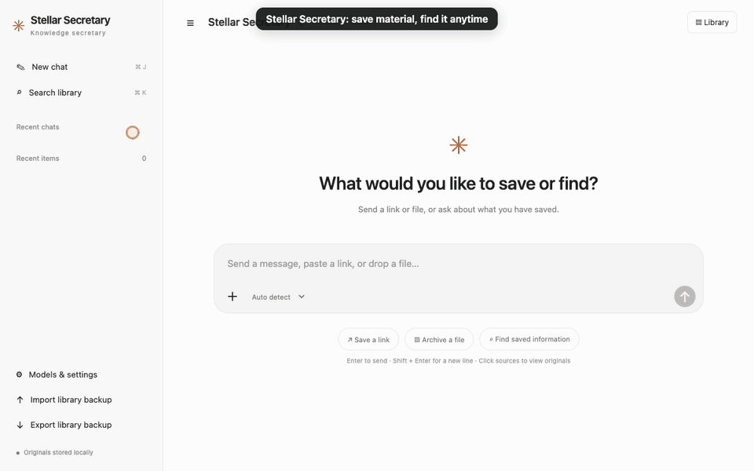

# Stellar Secretary

[简体中文](README.md) · **English** · v0.1.31

A local knowledge library for links, AI conversations, PDFs, documents and notes. Save originals, generate summaries using your signed-in local model CLI, and find material again with search or source-backed answers.



The demo uses fictional documents and a prewritten summary. Waiting is accelerated; it does not show actual model latency.

## Install and update

Download the installer from [GitHub Releases](https://github.com/StellarStar255/stellar_central_secretary/releases/latest).

- **Apple Silicon Mac:** open the DMG, drag Stellar Secretary into Applications, then launch it. macOS releases use Apple Developer ID signing and notarization.
- **Windows 10/11 x64:** run the setup EXE.

Installed builds include Python and the browser automation driver. Automatic ChatGPT capture also needs Google Chrome. AI summaries and answers require a locally installed, signed-in Codex CLI or Claude Code.

In **Models & settings → Display language**, choose **English** or **简体中文**. The interface updates immediately and remembers your choice across desktop and browser modes. Saved titles, originals and existing summaries are not translated.

Use **Models & settings → Version & updates → Check for updates** to install a newer release. Updates preserve your data and verify installer checksums; macOS also verifies the developer signature. Wait for active tasks to finish before updating.

## Learn with examples

Open **Models & settings → Getting started**, or download [the offline tutorial](docs/tutorial.html) and open it in a browser. Select English in the tutorial header if needed.

Six hands-on exercises cover:

1. Save a sample PDF with its original and overview.
2. Search using space-separated keywords: all must match, in any order.
3. Rename an item by clicking its title or pencil.
4. Open the original PDF in a browser or the system's default app.
5. Find desktop/browser switching inside settings.
6. Understand what is included in a library backup.

The tutorial uses fictional material, makes no model calls and does not access library APIs. Changing the tutorial's language does not change your app preference.

## Everyday use

- Send a link, attach a file with **+**, or drop files into the composer.
- Choose **Save as note** to keep plain text instead of asking a question.
- **Search library** supports keywords across titles, text, summaries, tags and filenames. `June Science Monthly` and `Science Monthly June` give the same matches.
- Click an item to view its summary and full text. Rename by clicking the title. Renaming alone does not trigger AI processing.
- PDF overviews use the first five pages by default. The full extracted text and original are retained. Select **Summarize full document** when needed.
- AES-encrypted PDFs without an opening password are supported. Password-protected documents must first be exported as accessible copies. Scanned PDFs need OCR.
- On macOS, choose **Models & settings → Interface mode** to switch between a native desktop window and your browser. Both share the same library and chat history. Closing the window keeps the app in the menu bar; click the Dock icon to reopen it.
- For authenticated or dynamic webpages, choose **Read webpage in browser**, sign in and expand the content, then click **Page is ready, start reading**. Failed direct text fetches open this flow automatically. Capture includes loaded text and HTML tables, with an explicit scope note; it does not load all comments or pages. Success closes only the new task tab according to settings; failure leaves it open. Canvas, iframe and restricted content may require the extension or manual text.
- The browser extension is an alternative for capturing conversations from an already signed-in browser.

## Data and backups

Data stays outside the replaceable application bundle:

- macOS: `~/Library/Application Support/Stellar Secretary`
- Windows: `%LOCALAPPDATA%\Stellar Secretary`

Use **Export library backup** for a ZIP containing originals, the database and a JSON list. **Import library backup** merges items and skips duplicates. Archived originals may use item IDs as filenames; downloading through the app restores the original filename.

The app listens on `http://127.0.0.1:8768`. Original material stays on your computer; AI features send relevant text to your selected model provider and use that account's quota. Backups exclude browser sign-in credentials.

## Development

See the [Chinese README](README.md) for source startup and packaging instructions. UI translations are maintained in `secretary/static/locales.json` and shared with native macOS menus.

```sh
python scripts/build_locales.py
python scripts/build_tutorial.py
python scripts/check_i18n.py
python scripts/check_tutorial.py
```

To regenerate the demo GIFs on macOS with Chrome and `scripts/requirements-demo.txt` installed:

```sh
python scripts/make_demo.py --lang zh
python scripts/make_demo.py --lang en
```

The recording scripts use isolated temporary data and never call a model or read the installed user's archive.

In item details, use **+ Add tag** or the × on a tag to maintain your own searchable tags. Manual changes survive AI regeneration and backup restore.

**My quick notes**, above Summary, autosaves text and pasted, dropped or selected images locally. Notes and images stay separate from AI content and are included in ZIP backups. Note text is searchable in the library and excluded from AI summaries and questions. Limits: 20,000 characters, 8 PNG/JPEG/GIF/WebP images, 5 MB each.

Idle dedicated browsers with no other pages exit after capture when automatic tab closing is enabled. **Models & settings → Close capture browsers** also closes the dedicated instances and their pages while keeping sign-in data. Your regular browser stays open.
