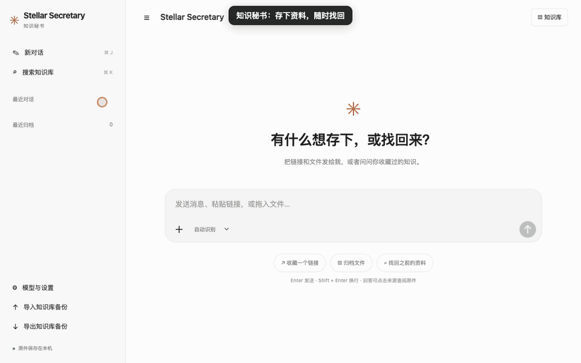

# Stellar Secretary · 知识秘书

**简体中文** · [English](README.en.md)

版本 **v0.1.33** · [MIT License](LICENSE) · [发布说明](docs/releases/v0.1.33.md)

本地个人知识管理器：投放网页、AI 对话、文件和笔记，自动生成摘要、主题和标签；通过全文搜索或带来源的问答重新取回。知识库搜索支持空格分隔多个关键词，全部包含、顺序不限，可跨标题、正文、标签和文件名匹配。参考 `stellar_little_red_book_search_and_reminder` 的本机 CLI 接入方式。



[English demo / 英文动图](docs/demo-en.gif)

<sub>动图使用虚构 PDF 和预置摘要，等待过程已加速；不代表真实模型处理速度。</sub>

**交互教程**：安装后打开「模型与设置 → 使用教程」，或下载 [离线教程 HTML](docs/tutorial.html) 后直接用浏览器打开。六个可点击练习涵盖归档、组合搜索、标题修改、PDF 阅读、模式切换与备份；不访问你的知识库、不改程序设置，也不调用模型。

## 安装与升级

从 [GitHub Releases](https://github.com/StellarStar255/stellar_central_secretary/releases/latest) 下载安装包：

- **macOS Apple 芯片**：打开 `Stellar-Secretary-*-macos-arm64.dmg`，把 Stellar Secretary 拖入「应用程序」，双击启动。
- **Windows 10/11 x64**：运行 `Stellar-Secretary-*-windows-x64-setup.exe`，按提示安装，支持桌面快捷方式和卸载。

安装版自带 Python 与 Playwright 驱动；登录读取仍需 Google Chrome，AI 摘要和问答仍需已登录的 Codex CLI 或 Claude Code。主界面支持网页模式，macOS 安装版也可使用独立桌面窗口。macOS 安装版常驻菜单栏和 Dock：菜单栏使用与 Dock 一致的橙色星芒专属图标，通过角标圆点显示状态，悬停或展开菜单查看启动、就绪、处理中和异常详情，支持打开主界面、资料目录、日志和退出。处理任务时 Dock 显示状态角标；关闭网页后后台继续运行，点击 Dock 图标可重新打开页面。Windows 关闭页面后后台继续运行，再次双击应用可重新打开页面。

在「模型与设置 → 显示语言」选择「简体中文」或「English」即可即时切换界面，选择会保留并同步到网页和桌面模式。资料标题、原文和已有摘要不会被翻译。交互教程跟随当前语言，也可在教程页单独选择语言；教程内切换不改变程序设置。

在「模型与设置 → 版本与升级」点击「检查更新」，有正式新版时点击「一键升级并重启」。程序验证 SHA256，macOS 额外验证开发者签名，安装后重启；有读取或摘要任务时请先等待完成。macOS 请先把应用拖到「应用程序」，从 DMG 直接运行时会转为手动安装。

安装版数据目录：macOS 为 `~/Library/Application Support/Stellar Secretary`，Windows 为 `%LOCALAPPDATA%\Stellar Secretary`。升级和卸载保留资料。首次从源码版迁移时，先停止旧服务并备份，将原项目 `data` 目录的全部内容复制到对应安装版目录，再启动应用；不要同时启动两版。对话记录使用本机共享存储，供网页与桌面共用；首次刷新新版网页时会迁移该浏览器的原有历史，本地浏览器记录继续作为后备。

## 源码启动

下载 Release 源码并解压，或克隆仓库后进入项目目录。macOS 下使用以下启动方式：

更新程序代码后，双击 **重启知识秘书.command** 可停止当前项目的旧服务并启动新版。重启脚本仅处理默认端口 8768，并验证进程确属本项目。

在 Finder 双击 **启动知识秘书.command**，或在终端运行：

```sh
./start.sh
```

浏览器自动打开 http://127.0.0.1:8768 。关闭终端或按 Ctrl+C 停止服务，下次启动保留全部资料。需要 Python 3.10+；核心归档和检索仅依赖标准库。启动脚本创建项目内 `.venv` 并安装 PDF 解析用的 `pypdf` 和浏览器读取用的 `playwright`；安装失败时仍可启动，原文件仍可保存。

```sh
./start.sh --port 8770 --data-dir /你的资料目录
```

自定义端口时，浏览器扩展的本地地址和 manifest 权限也需一起修改。

## 使用

PDF 支持无需打开密码的 AES 加密文档与特殊字体文字提取。解析失败时在资料详情查看具体原因，并可点击「重新解析原文件」，无需重新上传。需要打开密码的 PDF 请先用密码打开并导出可读取版本；扫描件仍需 OCR。PDF 默认只用前 5 页生成概览，并明确标注范围；原文件和完整提取正文仍保留。需要时可在资料详情点击「生成全文摘要」。

左下角「导入知识库备份」或「知识库 → 导入知识库备份」可导入本程序导出的 ZIP。导入会合并资料、摘要、标签和原文件，并跳过重复项；当前资料保留。普通文件仍从输入框「＋」导入。

「模型与设置 → 会话读取范围」默认快速读取最近最多 20 轮；也可选择当前已加载内容或完整会话。部分采集会标注范围，已有完整正文会保留并将最近片段另存。部分摘要仅处理最近片段，超长片段最多使用最近 4 万字符。

「模型与设置」可选择后台打开读取浏览器，以及读取后自动关闭本次新开的网页，默认均开启。需要重新登录时会显示任务标签页并等待确认；已有标签页和登录状态保留。

首页采用对话界面，底部输入框统一接收消息、链接和文件：

- 粘贴链接后按 Enter，会在对话中返回归档卡片；公开 HTML 页面尝试提取正文。
- 点击「＋」、拖入或粘贴文件，附件先显示在输入框中，点击发送后归档。支持多文件。
- 直接输入问题，从已收藏正文中检索并回答；来源显示在回答下方，点击即可查阅原件。
- 要保存文章、笔记或对话正文，将输入框下方「自动识别」切换为「保存为笔记」。
- Enter 发送，Shift+Enter 换行；侧栏「新对话」开启新的对话。
- 点击侧栏「搜索知识库」或右上「知识库」，按标题、正文、标签、文件名等搜索，可按类型和主题筛选。⌘K / Ctrl+K 打开搜索，⌘J / Ctrl+J 新建对话。
- 点击资料卡片可打开原链接、复制地址、下载原件、补充正文或重新整理。摘要在后台生成，卡片会自动更新。

对话记录保存在当前浏览器的本地存储中，刷新后恢复；知识库正文、原件和摘要独立保存在本机数据库中。切换浏览器或清除站点数据会清除该浏览器的对话记录，归档资料仍保留。ZIP 备份覆盖知识库资料，不包含浏览器对话记录。

### 登录后采集普通网页

飞书项目等需要登录或动态加载的网页，直接抓取没有正文时会打开专用 Chrome。也可在资料卡片或详情中点击「浏览器读取网页」。请手动登录、展开工作项及目标评论，再点击「页面已打开，开始读取」。链接的查询参数和片段保留。

只归档确认时已经加载的可读文字及 HTML 表格；不自动遍历分页、展开全部评论或读取未加载内容。摘要标注「网页已加载内容归档」。画布、内嵌页面和站点访问限制可能需要扩展或手动补充。成功后按设置关闭本次新开的标签页，失败时保留页面；不关闭已有标签页。网页账号登录和 AI CLI 登录相互独立。

### 在同一浏览器窗口中登录和读取 ChatGPT

首次发送 ChatGPT 会话链接后，程序打开专用 Chrome 窗口。请在其中自行登录并打开目标会话，回到知识秘书点击「我已登录，开始读取」。程序通过本机 CDP 连接这个**仍在运行的浏览器实例**，直接复用原有上下文和页面，不关闭重开浏览器，不新建未登录的浏览器上下文。目标对话已经打开时，也不刷新该页面。

- 登录阶段由你操作；程序在确认后连接并读取。Google 或 ChatGPT 仍可能拒绝某些浏览器访问，遇到限制可使用常用浏览器采集扩展。
- 读取成功、失败、取消或知识秘书退出时，都不会主动关闭这个 Chrome 窗口。保持窗口打开可复用当前登录状态。
- 后续导入会验证本地连接对应同一个浏览器实例，然后复用它；关闭浏览器后，下一次会启动新实例，是否需要再次登录取决于网站保留的登录状态。
- 浏览器配置在 `data/browser-live-profile/`。连接只监听本机回环地址，连接信息存入该目录中权限受限的文件；原始登录资料和连接信息不进入 ZIP 备份。
- 从旧版迁移到 v0.1.4 时，会使用新的专用目录；第一次需在新窗口登录一次。旧版浏览器目录保留，不迁移 Cookie 或密码。
- 该窗口仅用于知识采集；程序只提取目标会话中标记为用户和助手的消息，不读取登录表单，不代输密码，不点击登录或验证码。
- 登录等待最长 10 分钟，确认后正文读取最长 90 秒。当前窗口未登录时会直接提示，保留窗口供你完成登录。
- 网页登录用于读取私有会话，本机 Codex / Claude CLI 登录用于生成摘要，两者独立。需安装 Google Chrome 和启动脚本提供的 Playwright 包。

本流程针对关闭重开导致会话丢失的问题做了模拟回归验证，包括：连接原浏览器、复用原上下文、保留页面、不关闭浏览器、未登录页面的明确提示。真实 Google 登录和 ChatGPT 会话采集仍需在用户桌面环境验证。长对话只总结实际读取到的正文，可在资料详情核对。

Claude 私有链接目前使用下述扩展或粘贴正文方式。

### 浏览器扩展（备选方式）

1. 打开 `chrome://extensions`（Edge 为 `edge://extensions`），启用「开发者模式」。
2. 点击「加载已解压的扩展程序」，选择本项目的 `browser-extension` 文件夹。
3. 打开你已经登录的对话，等正文加载完，点击扩展的「一键归档当前页面」。
4. 本地服务运行时直接存入知识库；未启动时下载 `.knowledge.json` 文件，下次拖入即可。

扩展仅在点击时读取当前标签页已加载的文字；选中文字时只保存选区。也可以将对话直接粘贴到知识秘书，切换为「保存为笔记」。启用自动总结后，读取到的文字会发送给当前所选的模型服务。

### 文件格式

| 格式 | 支持情况 |
|---|---|
| TXT、Markdown、CSV、TSV、JSON、HTML、常见代码和日志 | 提取文字 |
| DOCX、PPTX、XLSX、ODT | 提取文字、幻灯片正文、表格单元格值；保留原件 |
| PDF | 安装 pypdf 后提取文字及页码 |
| 图片、扫描 PDF、音视频、旧版 DOC/XLS、其他二进制文件 | 保存原件，可手动补充正文；暂无 OCR / 转写 |

不执行 Office 宏，不计算表格公式；XLSX 读取已保存的计算值。正文按 1,200 字符分段，重叠 200 字符。超过 24 万字符的资料完整保存并索引，但暂不自动摘要，需要拆分；正文总上限 200 万字符。

## 本机 AI

在「模型与设置」选择：

- **ChatGPT · Codex CLI**：调用本机 `codex exec`，复用已有 CLI 登录。
- **Claude · Claude Code**：调用本机 `claude -p`，复用已有登录。

无需另填 API Key。需要相应 CLI 可用且已经登录；仅安装 ChatGPT/Claude 桌面 App 并不等同于 CLI 已登录。程序会检测本机可用的 CLI，实际登录状态和账户额度在调用时验证。调用使用账户对应额度，资料会发送给对应的在线模型服务；原件存储、搜索和下载可离线使用。

程序关闭模型工具、外部 MCP 配置和联网搜索，模型仅处理显式传入的资料文本。摘要任务在后台串行处理；长文按段落先提炼后汇总。失败或超时在详情中显示，不阻碍归档。可关闭自动 AI，稍后逐条点击「重新整理」。

Codex 非交互调用依据：[官方文档](https://learn.chatgpt.com/docs/non-interactive-mode)。

## 检索与当前边界

这一版是**关键词检索驱动的 RAG**，使用 SQLite FTS5 / BM25 和中英文分词，中文采用双字组合；列表额外支持正文直接子串查询。问答取排名前 8 个正文段落，再让模型附来源作答。当前没有向量嵌入、语义改写检索、多轮对话或全库跨文档长篇综合；同义词表达可能漏检，可用原文关键词重试。来源卡片展示实际使用的片段，回答中的编号由模型生成，应与卡片核对。

正文补充后会重建段落索引并清除旧摘要。相同文件按内容去重，链接按原地址去重，笔记按正文去重；同一网址已收藏且缺正文时，扩展或正文导入会自动补全；已有正文时再次提交不会覆盖，请通过详情编辑更新。

## 数据和恢复

默认数据全部在项目的 `data/` 中：

- `archive.sqlite3`：正文、索引、摘要、标签和设置。
- `files/<资料ID>`：原始文件，下载时恢复原文件名。

侧边栏「导出完整备份」下载 ZIP，包含数据库一致性快照、原文件和可独立阅读的 `archive.json`。浏览器登录目录不进入备份，也不导出 Cookie。恢复时先关闭程序，将备份解压到一个**新的空文件夹**，再用 `./start.sh --data-dir /该文件夹` 启动；不要覆盖运行中的数据库。

服务仅监听本机地址，使用 Host 校验和随机请求令牌。无遥测、无远程托管。数据目录不加入 Git。

发布源码前运行 `python3 scripts/check_public_files.py`；数据目录、浏览器会话、截图和导出备份应留在本机。数据发送范围及发布检查说明见 [SECURITY.md](SECURITY.md)。

## 验证

```sh
python3 -m unittest discover -s tests -v
node --check secretary/static/app.js
node tests/test_chat_ui.cjs
node --check browser-extension/popup.js
```

测试覆盖：登录读取后自动索引和总结、登录读取失败保留旧资料、目标会话 URL 校验及排除登录页消息、去重、中英文检索、正文更新后的索引替换、Office/HTML 提取、私有会话导入、原件备份恢复、AI 失败时数据保留、基于真实来源的问答装配、HTTP 令牌与主机校验。HTTP 测试通过内存套接字运行，无需绑定本地端口。浏览器读取和模型调用使用 mock；端到端真实登录及账户调用需在可联网的桌面环境验证。

对话界面另有 Node 冒烟测试，通过模拟 DOM 与 API 验证启动、发送链接、带来源问答、保存笔记、浏览器历史持久化和新对话；此检查不替代真实浏览器的视觉核验。

登录后的读取使用独立浏览器目录，并通过 CDP 连接原窗口，依据 [Playwright 官方文档](https://playwright.dev/python/docs/api/class-browsertype#browser-type-connect-over-cdp)。

Google 可能拒绝受软件自动化控制的浏览器登录，参见 [Google 账号帮助](https://support.google.com/accounts/answer/7675428?hl=en)。

v0.1.4 改为通过 CDP 连接仍在运行的浏览器，不再关闭重开窗口。前端检查此能力，旧服务须通过启动脚本重启后生效。

## 读取失败时检查当前已登录窗口

双击「读取当前会话.command」。它使用当前仍在运行的专用 Chrome，直接运行最新采集逻辑，不重启知识秘书、不关闭浏览器，也不要求重新登录。它会显示目标标题、识别的消息数量和等待原因。读到正文后，自动提交给已经运行的知识秘书；服务未运行时，正文直接保存到本地数据库，同时备存 `data/last-capture.knowledge.json`。

结构诊断保存在 `data/last-capture-diagnostic.json`，包含目标页面标题、消息数量、提取方式、可见生成按钮和有限的 DOM 属性提示，不保存密码或 Cookie。采集器检查所有同链接标签页，优先选择有正文的页面；隐藏的生成按钮不再阻止采集。

## 正文已保存但摘要连接失败

双击「重试摘要.command」，直接使用已保存的正文调用当前设置的 Codex / Claude，无需重新读取网页，也无需重启主服务。成功后刷新页面查看摘要。该脚本不会重复启动已经处于处理中的资料。

模型子进程会检查继承的本地代理是否拒绝连接。无可用配置时，检查系统代理与正在运行的本机代理进程；自动发现的代理必须通过 HTTP CONNECT 验证才能采用。此选择只作用于模型子进程，不修改系统代理或 CLI 配置。连接方式和结果保存在 `data/last-ai-diagnostic.json`，不包含代理密码、Cookie 或模型提示正文。

会话补读会先加载顶部历史，再逐屏向下收集，到达底部且消息稳定后保存。超出范围或仍未稳定时报告失败并保留原正文。替换前的正文、摘要及标签保存在 `data/capture-history/`；新正文显著短于旧版时不会覆盖。该过程只能确认页面中可加载的消息，网页未提供的历史仍需导出文件补充。

搜索支持少量有上下文约束的简称规则，例如“四人帮／文革”语境下的“反对毛”“毛的支持”可通过“毛泽东”检索；普通“毛衣”等词不会据此匹配。此功能不是通用语义向量检索。

## 构建与发布安装包

```sh
python3 -m venv .venv
.venv/bin/python -m pip install -r requirements.txt -r packaging/requirements-build.txt
bash packaging/build_macos.sh
```

产物在 `dist/`。Windows 在安装 Inno Setup 6 后运行 `pyinstaller packaging/stellar-secretary.spec --noconfirm`，再运行 `iscc /DAppVersion=0.1.33 packaging/windows_installer.iss`。

GitHub Actions 的 Build & Release 支持手动构建；推送与 `secretary/__init__.py` 一致的 `v*` 标签时，测试、构建两平台安装包并上传到 Release，同时发布自动更新需要的 `SHA256SUMS.txt`。未配置 CI 苹果签名和公证凭据时只生成草稿；需以本机签名公证后的 DMG 替换草稿附件、重算校验和后再公开发布。发布说明放在 `docs/releases/v版本号.md`。当前自动构建 macOS arm64、Windows x64。

macOS 签名公证使用仓库 Secrets：`MACOS_CERT_P12`、`MACOS_CERT_PASSWORD`、`MACOS_SIGN_IDENTITY`、`APPLE_ID`、`APPLE_TEAM_ID`、`APPLE_APP_PASSWORD`。本地可设置 `MACOS_SIGN_IDENTITY` 和 `NOTARY_PROFILE`。自动替换只接受与 `secretary/updater.py` 中 `TEAM_ID` 一致的签名。未配置证书时能生成临时签名 DMG，但无法作为一键替换的更新目标；首次打开需在系统设置的「隐私与安全性」中允许。Windows 安装程序未做代码签名。

### 会话中的表格与图表

v0.1.8 起，登录读取和浏览器扩展会把 HTML 表格保存为结构化文本，在归档详情中显示为可横向滚动的表格；旧正文仍保留制表符时也可直接恢复表格布局。可读取的内联 SVG 图表保存为静态图形快照，保留曲线、坐标和图形文字。读取范围包含完整回答，避免遗漏位于角色正文之外的图表。

图表快照不包含原站的悬浮提示或交互。Canvas、iframe 和跨域嵌入内容暂不转存图形，会显示打开原链接的提示。旧版已经丢失的图形需在资料详情重新「登录并读取对话」；更新浏览器扩展后请在扩展管理页重新加载扩展。快照标签参与检索和摘要，绘图坐标不参与。

v0.1.9 补齐新版 ChatGPT 的 search-unit 消息容器和角色标题 DOM 采集路径；这两种页面结构同样保留表格、SVG 曲线和按钮式图例。图表的原始数据与说明可在图形下方展开，避免图形被散乱文本替代。

macOS 安装版支持独立桌面窗口和网页模式，在「模型与设置 → 使用方式」或托盘菜单中随时切换，程序记住选择。关闭桌面窗口后服务继续在托盘运行，点击 Dock 可重新打开。两种模式共用知识库、设置和本机对话记录；旧浏览器对话会在刷新页面后迁移到本机共享存储。

## 更新教程与动图

教程的源文件位于 `secretary/static/tutorial.html`、`tutorial.css` 和 `tutorial.js`，应用内与离线版使用同一套内容。

```sh
python scripts/build_locales.py
python scripts/build_tutorial.py
python scripts/check_tutorial.py
```

重新录制动图需 macOS 桌面会话与 Google Chrome，安装 `scripts/requirements-demo.txt` 后运行 `python scripts/make_demo.py --lang zh` 或 `python scripts/make_demo.py --lang en`。录制使用临时资料库、虚构 PDF 和预置摘要，不读取已安装应用的数据、不调用模型。输出为 `docs/demo.gif` 与 `docs/demo-en.gif`。

资料详情中可点击「＋ 添加标签」，输入后按 Enter 添加，点击标签旁的 × 删除。标签支持空格分隔多关键词搜索，也参与资料问答检索；手动维护后不会被 AI 重新整理覆盖，备份恢复也会保留。每份资料最多 50 个标签，每个最多 60 字符。

「资料摘要」上方的「我的速记」支持文字、粘贴/拖入/选择图片，修改后自动保存在本机，也可点击「保存速记」。速记文字参与知识库搜索，速记和图片不参与 AI 摘要或问答，重新解析和整理原文不会覆盖速记；ZIP 备份包含速记及图片。每份最多 8 张 PNG/JPEG/GIF/WebP 图片，每张不超过 5 MB，文字最多 20000 字符。

勾选读取后关闭网页时，没有其他页面的空闲专用浏览器也会退出。在「模型与设置」点击「关闭专用浏览器」可关闭知识秘书的专用实例及其页面；登录目录保留，个人日常浏览器不受影响。

通用网页读取不拦截浏览器网络请求。等待登录或确认期间，页面的异步接口、嵌入页面和链接跳转可正常运行；程序在采集时核对实际页面地址，再读取已加载内容。

专用 Chrome 重启后，程序会核对专用资料目录与本地端口，自动更新失效的读取连接；不会清理登录资料或接管日常浏览器。普通网页读取失败的原因也会直接显示在资料卡片下方。
