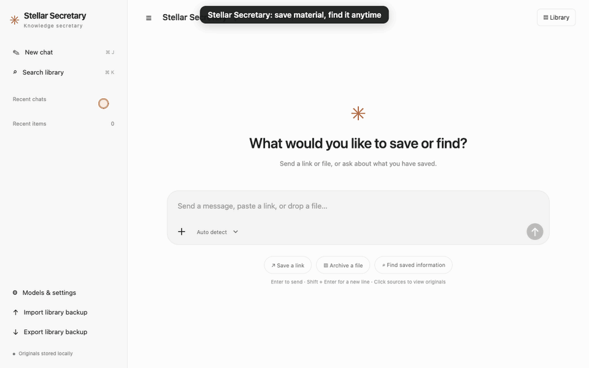
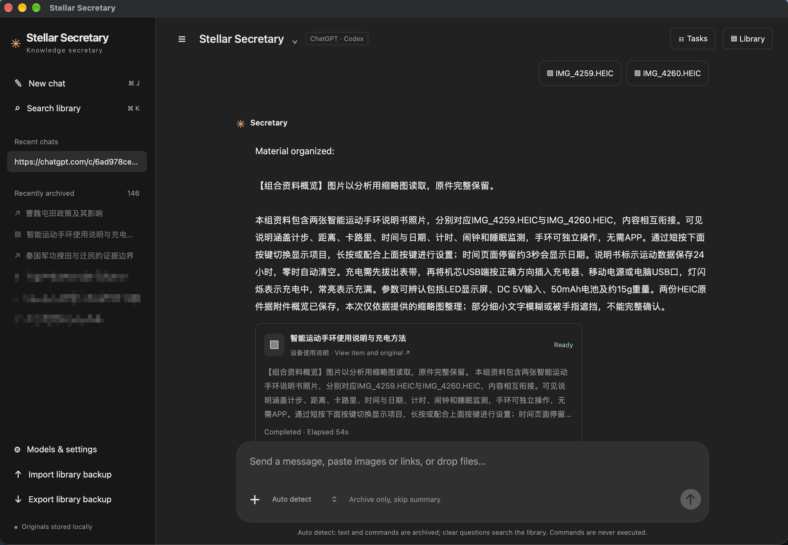
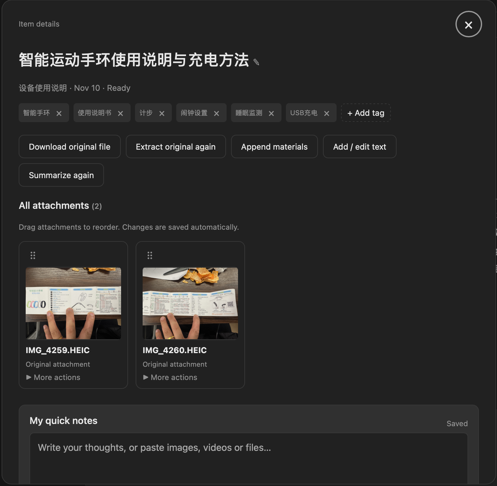
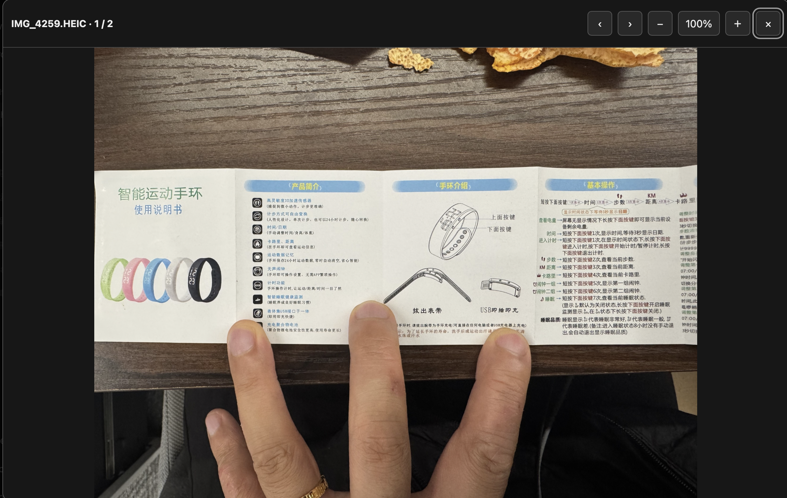
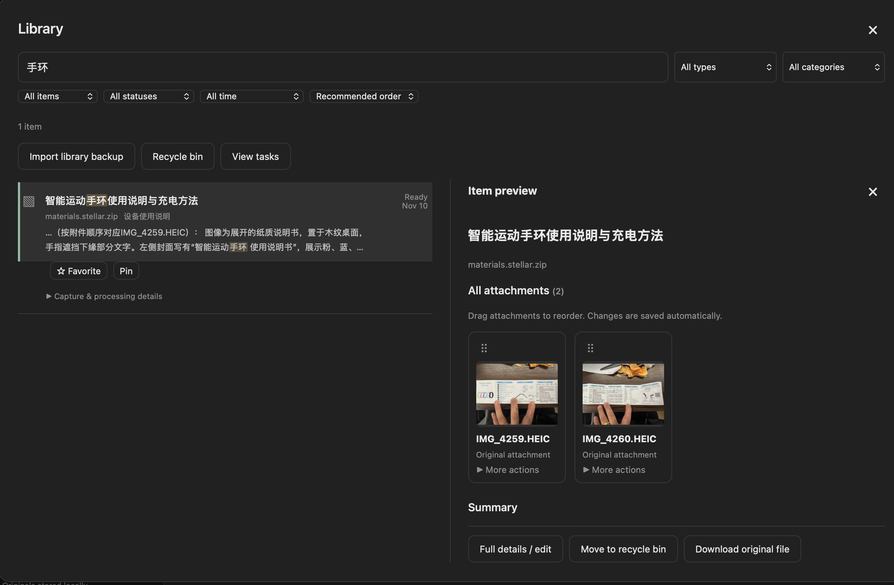

# Stellar Secretary

**English** · [简体中文](README.zh-CN.md)

Version **v0.1.104** · [MIT License](LICENSE) · [Release notes](docs/releases/v0.1.104.md)

HEIC/HEIF photos support local thumbnails, the in-app image viewer and visual summarization with an image-capable model. Originals stay intact; compatible JPEG images are generated locally for preview and analysis. Existing HEIC attachments work without re-uploading; use **Summarize again** to replace an earlier summary that did not read the image.

For Live Photo motion, import the photo and its matching same-name `.MOV` together (for example, `IMG_4259.HEIC` and `IMG_4259.MOV`), or append the MOV to the same item later. Open the photo and select **Play Live Photo** to watch, pause or seek the video; closing playback returns to the photo. Both originals remain available. A single still HEIC cannot provide missing motion; the viewer explains when no companion is available. Ambiguous same-name companions are not automatically paired.

A local knowledge library for links, AI conversations, PDFs, documents and notes. Save originals, generate summaries using your signed-in local model CLI or a configured model API, and find material again with search or source-backed answers.



The demo uses fictional documents and a prewritten summary. Waiting is accelerated; it does not show actual model latency.

## Chat with your library

Choose **Library chat** in the composer, or select **Chat with your library** on the welcome screen. Ask about saved material and continue with follow-up questions. Up to six recent successful question/answer pairs provide context; starting a new chat clears that context.

The configured CLI or compatible API first generates up to three keyword queries. The app searches its local full-text index, includes the original question as a fallback, combines results and sends up to eight retrieved passages to the model, with additional context from previously cited documents for follow-ups. Only cited sources are displayed. Source buttons open the archived material and show attachment/page information where available. Missing evidence produces a clear message. Prior answers help interpret the question and are not treated as factual evidence.

Text and URLs in this mode are questions; archive new attachments first. **Archive only** takes priority when checked. Existing model settings and company-data confirmation apply. A normal answer uses two model calls, for query planning and answering. By default, retrieval uses full-text search with model-expanded keywords. Enable local semantic search below to add vector retrieval.

Auto-detected questions use this same conversation pipeline. Once a conversation starts, ordinary clarifications, corrections and follow-ups keep receiving answers without relying on question words. Explicit save instructions, commands and archive modes remain available. Conversation intent persists across reloads and intermediate accidental archives in older chats. New chats clear archive-only and stale archive modes. Archive-only displays a clear warning and a Back to conversation button. Local date/time context and image date ranges constrain schedule answers; an older week’s empty cells do not establish today’s availability. When the user explicitly asks for a judgment based on that timetable, the answer gives a conditional conclusion with its assumptions and visible time range. Related saved images can be rechecked through bounded compatible previews when the selected model accepts images. Missing or unsupported image input is disclosed.

Library questions use a dedicated interactive lane, separate from background short summaries. Explicit short clarifications about recently cited material can reread that material and answer in one model call. New topics and long documents retain full query planning; image checks and source confirmation remain in place. Simple questions use a lower reasoning budget, while explicitly detailed analysis retains a higher budget where supported (currently Codex CLI). Expand **Processing time** beneath an answer to see queue, query-planning, search, image-preparation and answer durations.

Whole-message greetings and thanks receive an instant local reply without a model call or library search, even before model setup. They do not replace the cited conversation context. Pure chat or creative requests can finish in the first model call; questions about saved material still retrieve evidence before answering.
While a library question is running, the reply shows the current server stage and elapsed time: conversation preparation, queue, query planning, retrieval, image preparation, and answering. Progress contains only stage names and item counts, and clears when the request completes or fails.

### More complete conversations

Ask to list all records on a topic to receive a distinct record count and a paginated catalog (20 per page). The count covers the union of the displayed keyword searches across indexed text and metadata, excluding the recycle bin; it is not a guarantee of every semantically related record. Pagination queries the current library again, so counts can change if the library changes.

Explicit ownership confirmations, corrections and instructions to judge from a source are retained separately from the six recent turns, within the current conversation. Open **Conversation context** above the composer to review or clear these user-stated conditions. They remain assumptions, not verified source facts; they are not shared with a new chat. Source cards show an excerpt and attempt to locate it in the original; PDF citations retain page navigation.

For compatible APIs, enable **Stream answers** in API settings to show provisional text while generating. The complete answer and source numbers are checked before it is saved. Current CLI backends that return text only on completion continue to show live stage progress. In settings, optionally enable completion/failure notifications; native desktop notifications work independently of the hidden webview. Browser mode requires notification permission and may be delayed by browser background throttling. Notifications omit source titles and content; clicking opens Tasks for details and retry.

A small in-memory cache can reuse recent source-backed answers. It expires within five minutes and invalidates on question/context, minute/date/timezone, archived-record, original/added-file metadata, model configuration or semantic-index changes. It still checks company-data authorization. **Check again** bypasses the cache and rereads the material. Restarting clears the cache; it is not exported or shared across devices.

## Local semantic search

Enable **Models & settings → Local semantic search** to combine keyword retrieval with locally generated embeddings. Answers continue to use the selected CLI/API model and existing company-data confirmation.

Install and start [Ollama](https://ollama.com/download), then run `ollama pull bge-m3`. This multilingual embedding model is about 1.2 GB; see the [model page](https://ollama.com/library/bge-m3). The app does not download models automatically. Keep `http://127.0.0.1:11434` and `bge-m3`, test the embedding service, enable it and save. Other local models exposing [Ollama's embedding API](https://docs.ollama.com/api/embed) can also be configured.

Existing passages are indexed in background batches of up to 16; new and edited material updates automatically. Progress and errors appear in settings. Vectors live in the existing SQLite database and its backups, without extra Python ML dependencies or a separate vector database. Embedding requests accept loopback addresses only, bypass proxies and reject redirects.

If disabled or unavailable, keyword search remains usable. Incomplete indexing and service failures are disclosed in the conversation. Edits and trash/delete operations invalidate affected vectors, and writes check that the input still matches current material. Changing the model or URL invalidates the cache; rebuild manually after replacing weights under the same model name. Disabling preserves the cache. The adjustable similarity threshold defaults to 0.45 and depends on the model. Retrieval uses exact cosine scanning for personal libraries, rather than an approximate index for very large collections.

## Example: turn a paper manual into searchable material

Photograph both sides of a fitness-band manual and send the two HEIC photos together. Stellar Secretary keeps the originals in your local library and organizes their contents for later reference. These four screenshots follow the material from its first summary to finding it again.

### 1. Submit the photos together and get an overview

The two photos are organized into an item titled “智能运动手环使用说明与充电方法” (fitness-band instructions and charging). The overview covers button controls, step counting, time settings and USB charging, with an item card you can open. It also states that reduced images were used for analysis and that small, blurry or finger-obscured text could not be fully confirmed.



### 2. Open the details and add your own notes

The details bring together the title, category, tags and both original attachments. Reorder the photos, download originals, append more material or add your own usage notes in **My quick notes**. You can also summarize the item again later.



### 3. Enlarge a photo to check the manual

Click a thumbnail to view the photo inside the app. Use the previous/next and zoom controls to compare the pictures and check the instructions directly when you need a specific detail.



### 4. Find the item and its photos with a keyword

When you need the manual again, search the library for “手环” (fitness band). The preview keeps the attachments within reach: open a photo directly, or enter the full details to continue reading and editing.



The same workflow works for appliance manuals, equipment instructions and other paper references you want to keep. The screenshots use the English interface; the saved title and summary remain in Chinese.

## Install and update

Download the installer from [GitHub Releases](https://github.com/StellarStar255/stellar_central_secretary/releases/latest).

- **Apple Silicon Mac:** open the DMG, drag Stellar Secretary into Applications, then launch it. macOS releases use Apple Developer ID signing and notarization.
- **Windows 10/11 x64:** run the setup EXE.
- **Linux x64 (Ubuntu 22.04+ / Debian 12+, glibc 2.35+):** install the `.deb` with `sudo apt install ./Stellar-Secretary-*-linux-x64.deb`, then launch **Stellar Secretary** from the applications menu or run `stellar-secretary`. Alternatively, extract the `.tar.gz` and run `./Stellar-Secretary/start.sh`. Minimal portable systems need `libpulse0` and `libpulse-mainloop-glib0` for the native video player; the `.deb` declares these dependencies. Linux includes a desktop window, tray menu and a browser display mode selectable in settings. Closing the window minimizes it to the Dock/taskbar. GNOME requires AppIndicator support for tray icons; the Dock and application menu remain available without it. Python is bundled. Install a browser and Google Chrome separately for webpage capture.

Installed builds include Python and the browser automation driver. Automatic ChatGPT capture also needs Google Chrome. AI summaries and answers can use a locally installed, signed-in Codex CLI / Claude Code / Gemini CLI, or a configured OpenAI-compatible Chat Completions API. No CLI installation is needed for API mode.

For the regular-browser capture extension, open **Models & settings → Install browser extension**. The app exports its bundled extension to a persistent folder outside the app bundle and provides **Copy folder path**, **Open extension folder**, and a ZIP download. In `chrome://extensions` or `edge://extensions`, enable Developer mode, choose **Load unpacked**, and select that folder. On Mac, use `⌘⇧G` in the folder picker to paste the path. No source checkout is needed. Reload the extension from the browser’s extensions page when its files are updated.

In **Models & settings → Network & proxy**, choose the proxy type and enter its port number. You do not need to write a proxy URL. Start your proxy app, find its Ports / Inbound / Local proxy setting, and use the number it displays. For example, if it shows **HTTP / Mixed 7897**, choose a proxy on this computer and enter **7897**. The examples fill the form; use your actual port.

Model calls use HTTP / Mixed ports for Claude, Codex, Gemini and custom APIs. The dedicated capture Chrome can follow the system proxy, use the model route, connect directly, or use a separate **HTTP or SOCKS5** proxy. For **SOCKS 1080**, choose SOCKS5 and enter **1080**. Username/password proxy URLs are not supported. Your regular browser and capture extension retain their own settings. Save changes and close an already-open dedicated browser before capturing again; its sign-in data is retained.

**Check proxy port** tests the port without calling a model. **Test current model connection** then checks the selected model, showing elapsed time and the result. Local model APIs bypass external proxies. A reachable proxy port does not prove that the model account is signed in or that an external website is accessible.

For Gemini, install the current [Gemini CLI](https://geminicli.com/docs/get-started/installation/) (`npm install -g @google/gemini-cli`), run `gemini` once to sign in, then select **Gemini · Gemini CLI** in Models & settings. Text and explicitly attached images are supported; a Gemini website sign-in alone does not sign in the CLI. The adapter is verified with CLI 0.66.0 using a local simulated Gemini API.

In **Models & settings → Display language**, choose **English** or **简体中文**. The interface updates immediately and remembers your choice across desktop and browser modes. Saved titles, originals and existing summaries are not translated.

Use **Models & settings → Version & updates → Check for updates** to install a newer release. Updates preserve your data and verify installer checksums; macOS also verifies the developer signature. Wait for active tasks to finish before updating.

Linux installer builds also support updates from settings. Debian installation asks for system authorization; cancelling leaves the app running. Portable updates require a writable application directory and system Python 3, and restore the previous program if the replacement fails to start. Data must remain outside the program directory. You can also install a newer `.deb` manually. To run the service without a desktop host, use `stellar-secretary --no-browser`; Ctrl+C stops a terminal-launched instance.

## Learn with examples

Open **Models & settings → Getting started**, or download [the offline tutorial](docs/tutorial.html) and open it in a browser. Select English in the tutorial header if needed.

Six hands-on exercises cover:

1. Save a sample PDF with its original and overview.
2. Search using space-separated keywords: all must match, in any order.
3. Rename an item by clicking its title or pencil.
4. Open the original PDF in a browser or the system's default app.
5. Find desktop/browser switching inside settings.
6. Understand what is included in a library backup.

The tutorial uses fictional material, makes no model calls and does not access library APIs. Changing the tutorial's language does not change your app preference.

## Everyday use

- Send a link, attach a file with **+**, or drop files into the composer. Multiple links in one message become one archive by default, along with any text and attachments. **Group into one archive** also allows explicit grouping.
- Grouped links are saved first, then accessible public text is read in the background. Source statuses distinguish read and unread pages. Sign-in-only or unavailable pages retain their links and annotations; append their content manually when needed. Up to 20 links per group, with bounded text overviews.
- Paste an image directly, then add text and files before sending. They become one grouped archive with original attachments, previews and downloads. Select **Ask about these materials** to answer from this submission; ordinary annotations respect the automatic-summary setting. PNG/JPEG/GIF/WebP images can be analyzed by your selected image-capable model. Limits: 20 attachments and 8 images per submission, up to 1 GB per file and 2 GB total. Files above 8 MB use streamed 4 MB upload chunks; automatic extraction for other formats remains bounded to 50 MB, while larger PDFs read only the first 5 pages from disk (up to 8,000 characters per page), explicitly marked as partial. Repeated attachment contents are skipped within a submission and across later additions to the same archive. Analysis uses resized images and bounded document excerpts; grouped PDFs use the first five pages. Original files remain intact.
- Text submitted alongside links is saved as a searchable link annotation. If webpage text cannot be read, the annotation still provides the title and material for a clearly labeled summary. Later webpage capture retains it.
- **Auto detect** archives commands and ordinary knowledge text by default; clear questions search the library. Choose **Archive text / commands** to force archiving, or **Ask about this material** to force a question. Command text, indentation and embedded URLs are retained as material; commands are never executed.
- **Search library** supports keywords across titles, text, summaries, tags and filenames. `June Science Monthly` and `Science Monthly June` give the same matches.
- Open any archive and choose **Append materials** to add new text, pasted images and files to that same record. Enable **Generate a supplemental summary after saving** to append dated findings while retaining the original summary, title, tags and source. Each batch can be previewed, downloaded and summarized again; appended text and image descriptions are searchable and included in backups.
- Click an item to view its summary and full text. Rename by clicking the title. Renaming alone does not trigger AI processing.
- PDF overviews use the first five pages by default. The full extracted text and original are retained. Select **Summarize full document** when needed.
- AES-encrypted PDFs without an opening password are supported. Password-protected documents must first be exported as accessible copies. Scanned PDFs need OCR.
- On Windows, macOS and Linux, choose **Models & settings → Interface mode** to switch between a native desktop window and your browser. Both share the same library and chat history. Closing the window keeps the app running in the notification area (Windows) or menu bar (macOS). Use the tray menu or reopen the app to restore its window. Windows includes its own Chromium engine; no separate WebView2 installation is needed.
- For authenticated or dynamic webpages, choose **Read webpage in browser**, sign in and expand the content, then click **Page is ready, start reading**. Failed direct text fetches open this flow automatically. Capture includes loaded text and HTML tables, with an explicit scope note; it does not load all comments or pages. Success closes only the new task tab according to settings; failure leaves it open. Canvas, iframe and restricted content may require the extension or manual text.
- The browser extension is an alternative for capturing conversations from an already signed-in browser.

Right-click a recent archive, library row or archive card and choose **Delete archive…**. Confirmation removes the record, originals, quick notes, capture-history copies, search entries and conversation messages that reference it. Other archives are retained, and stale conversation sync cannot restore the deleted messages. Exported backups, original websites and external open windows are unaffected.

## Data and backups

Data stays outside the replaceable application bundle:

- macOS: `~/Library/Application Support/Stellar Secretary`
- Windows: `%LOCALAPPDATA%\Stellar Secretary`
- Linux: `${XDG_DATA_HOME:-~/.local/share}/stellar-secretary`

Use **Export library backup** for a ZIP containing originals, the database and a JSON list. **Import library backup** merges items and skips duplicates. Archived originals may use item IDs as filenames; downloading through the app restores the original filename.

The app listens on `http://127.0.0.1:8768`. Original material stays on your computer; AI features send relevant text and submitted images to your selected model provider and use that account's quota. Backups exclude browser sign-in credentials.

## Development

See the [Chinese README](README.zh-CN.md) for source startup and packaging instructions. UI translations are maintained in `secretary/static/locales.json` and shared with native macOS menus.

```sh
python scripts/build_locales.py
python scripts/build_tutorial.py
python scripts/check_i18n.py
python scripts/check_tutorial.py
```

To regenerate the demo GIFs on macOS with Chrome and `scripts/requirements-demo.txt` installed:

```sh
python scripts/make_demo.py --lang zh
python scripts/make_demo.py --lang en
```

The recording scripts use isolated temporary data and never call a model or read the installed user's archive.

In item details, use **+ Add tag** or the × on a tag to maintain your own searchable tags. Manual changes survive AI regeneration and backup restore.

**My quick notes**, above Summary, autosaves text and pasted, dropped or selected images locally. Notes and images stay separate from AI content and are included in ZIP backups. Note text is searchable in the library and excluded from AI summaries and questions. Limits: 20,000 characters, 8 PNG/JPEG/GIF/WebP images, 5 MB each.

Idle dedicated browsers with no other pages exit after capture when automatic tab closing is enabled. **Models & settings → Close capture browsers** also closes the dedicated instances and their pages while keeping sign-in data. Your regular browser stays open.

Generic capture does not intercept browser requests. APIs, embedded pages and navigation continue while waiting for confirmation. Capture validates the actual page address before saving loaded content.

Local dynamic viewers and development services on `localhost`, `127.0.0.1` and IPv6 loopback can be captured after browser confirmation. Submit the complete URL; capture stays within that host, scheme and port and retains proxy paths, queries and fragments. Automatic server fetching remains public-only and other local services are not scanned. The local service must be running on the same computer as the capture browser.

After a local viewer redirects within that origin, confirmation reads the displayed index or conversation page without forcing navigation back to the entry point. Interrupted empty navigation is retried once. Persistent HTTP 204/205, downloads and HTTP errors receive distinct messages and are never saved as source text.

After dedicated Chrome restarts, capture verifies the exact profile and loopback endpoint before refreshing stale connection metadata. Sign-in data and regular browsers are kept. Generic webpage capture failures are shown beneath the item card.

Generic capture supports structured rich-document editors, display:contents wrappers and open Shadow DOM. After confirmation, up to four visible same-origin or Feishu/Lark document frames may be added within the total text budget. Hidden, unrelated or sign-in frames and ordinary comment/form drafts are excluded. Only loaded text is read; unloaded blocks and canvas OCR remain outside scope. After confirmation, capture saves a timestamped snapshot of visible text without waiting for progress bars, counters or the entire document to finish loading. Short status pages are supported; empty and loading-only placeholders still wait for text.

Use **Models & settings → Interface font size** to adjust text from 12 to 24 px. Drag to preview, release to save, or reset to 14 px. Desktop and browser modes share the preference, which survives reloads and restarts.

Use `Cmd +` / `Cmd =`, `Cmd -`, and `Cmd 0` to enlarge, reduce or reset reading content only; use Ctrl on Windows/Linux. The 70–200% content scale is saved independently of interface font size. Buttons, sidebar and composer keep their interface size.

## Custom model APIs

Choose **Models & settings → AI backend → Custom model API (OpenAI-compatible)**. Enter the API base URL, model name and API key, then test the connection and save. A DeepSeek example is provided; other compatible hosted services or local endpoints can be configured manually. HTTP is allowed for loopback endpoints; remote services require HTTPS. Services without authentication can use **No API key required**.

Enable image input only for an image-capable model. Otherwise images remain archived while summaries and answers explicitly use text only. JSON output mode is optional. Output limits support both `max_tokens` and `max_completion_tokens`, as required by the provider. Other native API protocols need a compatible endpoint or adapter.

The key is stored in a separate local `model-api.json` file, never returned to the UI, and excluded from library backups. Leave the key field empty to keep a saved key. Changing the endpoint requires re-entering it. After restoring a backup on another computer, configure the API credentials again. The connection test sends a short synthetic message, not library content; provider charges may apply.

Short text summaries target 1–3 sentences (up to 120 Chinese characters); medium text targets 100–200 characters. Long text retains segmented coverage. Short plain-text work and interactive questions use a separate lane from long documents: one task per lane, at most two model calls concurrently. This reduces blocking without interrupting active work.

Select **Archive only, skip summary** beside the composer to save searchable text, attachments and links without AI or automatic browser capture. Links stay unread until explicitly opened/captured; saved items are not automatically summarized after restart. Choose **Reorganize** later to generate a summary.

Archive cards and details show the current stage, elapsed time, waiting/preparation time and model time (including process startup, connection and generation). Timing records contain no document text or credentials and cover the latest 100 completed jobs in the current app session. Active windows refresh about once per second while work runs, and less often when idle; chat-history synchronization is throttled separately. Provider latency and CLI startup remain variable.

Common document attachments (including XLSX, DOCX, PDF, text and images) can be opened with their system default application, or revealed in their folder. This works for standalone files, grouped attachments and appended batches. Opened files keep their original names in a managed local editing folder; reopening preserves local changes. Compatible viewing/editing software must be installed.

After saving in the external app, click **Save changes to archive**. This explicitly updates the same archive/batch, the downloadable original and searchable text, while preserving unrelated attachments and the parent file. Previous file versions stay locally beside the editing copy under `open-files/<archive ID>/edits/.../history`; they are removed with the archive. Backups contain the latest saved original, not unsaved editing copies or local history. Existing summaries are marked potentially outdated and are not automatically sent to AI. Active processing and conflicting archive versions block save-back without discarding local work. Unsupported file types retain the download option.

### Local recovery and media

- Updates keep the previous program until the new process reports the expected version, a readable library and a loaded desktop window. Failed startup or version mismatch restores program files without reverting library data. System-managed Linux packages still require the operating system’s installation authorization.
- Title, text and quick-note edits save before closing or switching items; failed saves retain local recovery drafts. Explicit Cancel or Escape in an editor discards its unsaved changes. Concurrent edits are checked before overwriting.
- Video cards display a decoded cover and duration when the platform supports the codec. Playback resumes locally, resets near completion, and supports fullscreen through native video controls (or the Windows/Linux player’s Full screen button). Unsupported codecs retain the original download/default-app actions.
- Settings → Data & backups contains local snapshot and restore actions. Daily backups run while the app is running; a missed day is backed up at the next launch. Upgrade and pre-restore snapshots run before those operations. Retention is 7 daily snapshots and 3 each of manual, upgrade and pre-restore snapshots. Snapshots include the database, originals, notes and conversations, exclude browser sessions and API-key files, and stay under the library’s `local-backups` folder. Full local restore requires idle tasks and first saves the current library. ZIP imports stream to disk (8 GB compressed / 16 GB expanded limit) and merge records.
- Originals, grouped downloads, video ranges, single-attachment deletion and local backups stream from disk. A completed large upload is removed from staging; abandoned uploads expire after 24 hours on the next upload. Staging is limited to 4 GB. Edited file save-back remains limited to 50 MB per edited file, while unchanged large attachments are copied through in bounded blocks.


### Page reading, undo and resumable uploads (v0.1.73)

PDF attachments support explicit ranges of 1–10 consecutive pages, next-five-page continuation and local OCR. Selections are retained separately from originals, indexed for search and included in later summaries (up to 200 retained pages per item). Search/answer anchors open the owned attachment page. OCR uses Apple Vision on macOS, installed Windows OCR languages, or Tesseract on Linux; portable Linux users must install Tesseract and language packs. OCR makes no model call; summaries still follow the configured model and company-mode policy.

Attachment deletion can be undone immediately or from deleted-attachment history. Restoring one leaf merges it into the current item and keeps later title, body, note and other-attachment changes. Trashed or permanently deleted parents cannot use this endpoint.

Backup settings expose the folder, byte limit and retention counts, with last-success/usage status and nonmodal failure notices. The default storage limit is 10 GB. Old snapshots are pruned only after a new snapshot completes; a failed backup preserves previous snapshots. Previous backup folders remain accessible after changing location. Older snapshot schemas are migrated in staging before restoring the live database.

Large uploads support pause/resume, cancellation and resuming after restarting by reselecting the original file. Committed chunks are SHA256-checked before continuation, with at most 4 MB processed at a time. Independent consumer leases prevent one submission from deleting another submission's staging file. Unfinished staging expires after 24 hours and remains limited to 4 GB total.

### Reading and maintenance improvements (v0.1.74)

PDF viewing displays original pages immediately; extraction is explicit. Local text/OCR jobs report page progress, continue after closing the viewer and support cancellation without committing partial results. Summary coverage records the actual page text submitted; older summaries have unknown coverage until regenerated. Later additions can be summarized separately while retaining the earlier summary.

Library results are paged in SQL, with a trigram index for substring queries and SQL substring filtering for one/two-character searches. Dashboard refreshes fetch recent records and the current conversation/task references instead of the entire library.

Storage settings show usage and an explicit cleanup preview for expired uploads, deleted-attachment recovery copies and eligible older backups. No entries are selected automatically; previews expire after ten minutes and changed files require a new preview. Originals, databases and working edit copies are excluded. The newest and most recently verified backup in each folder are retained. Removing recovery copies and older backups is permanent.

New snapshots include a per-file SHA256 manifest and pass database/original/reference checks before success and retention pruning. Older snapshots can be checked with their legacy limitations shown. An inconsistent state preserved before recovery is labeled accordingly and does not prevent restoring a verified good snapshot. Verification never replaces the current library.
