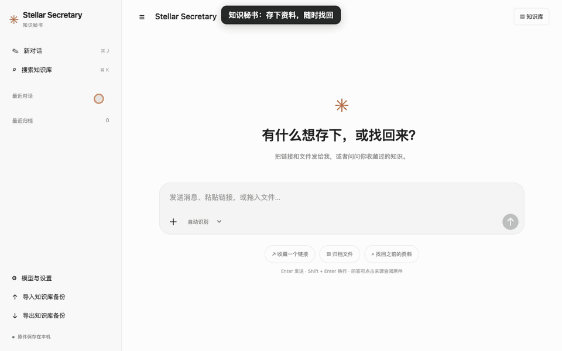
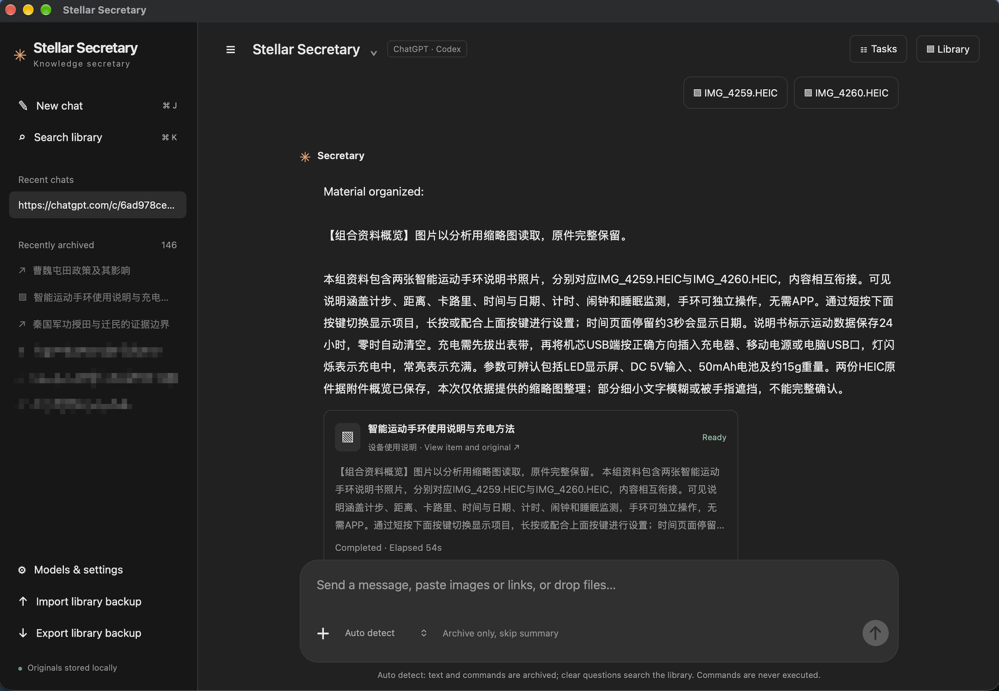
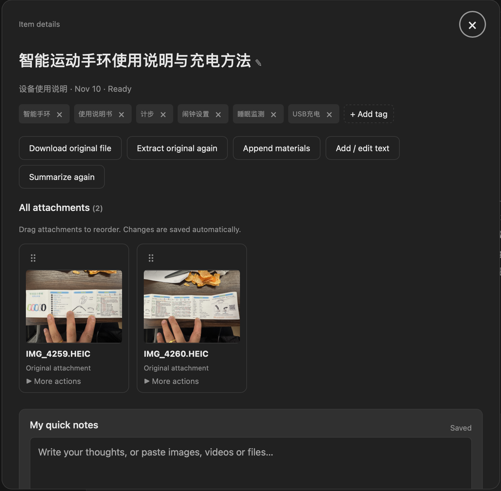
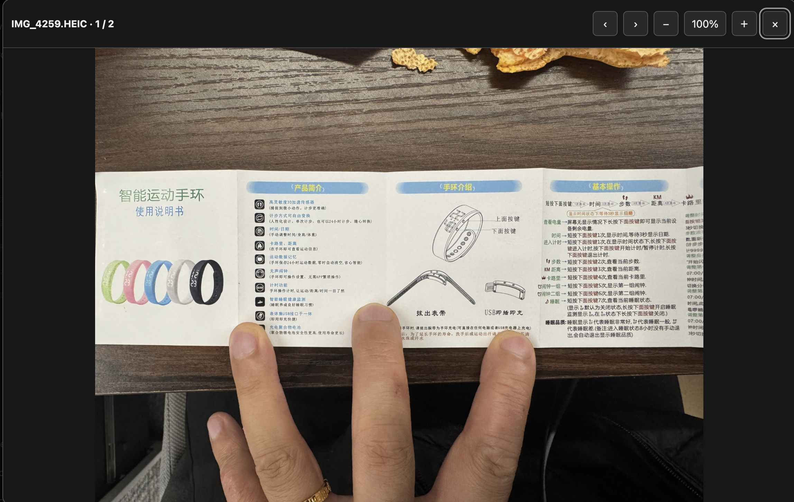
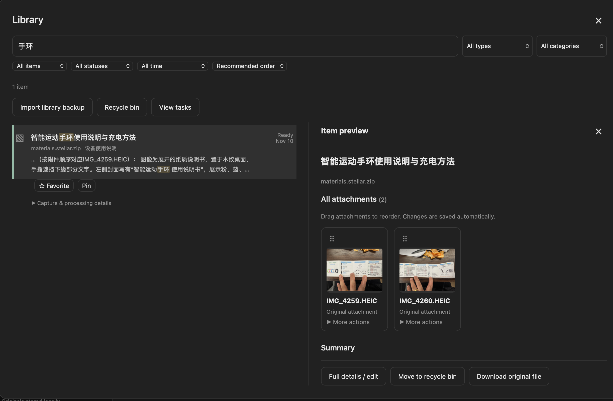

# Stellar Secretary · 知识秘书

[English](README.md) · **简体中文**

版本 **v0.1.87** · [MIT License](LICENSE) · [发布说明](docs/releases/v0.1.87.md)

HEIC/HEIF 照片支持本地缩略图、应用内查看和视觉总结（需支持图片输入的模型）。原件完整保留，预览和分析使用本地生成的兼容 JPEG；已入库附件无需重新上传，旧摘要可通过“重新总结”更新图片内容。

播放实况照片时，将照片与配套的同名 `.MOV` 一起导入，例如 `IMG_4259.HEIC` 和 `IMG_4259.MOV`；也可后续把 MOV 追加到同一份资料。打开照片后点击“播放实况”，即可播放、暂停或拖动进度，关闭播放器返回照片，两份原件均保留。单张静态 HEIC 无法补出缺失的动态部分，查看器会提示未找到配套视频；同名候选不明确时不会自动配对。

本地个人知识管理器：投放网页、AI 对话、文件和笔记，自动生成摘要、主题和标签；通过全文搜索或带来源的问答重新取回。知识库搜索支持空格分隔多个关键词，全部包含、顺序不限，可跨标题、正文、标签和文件名匹配。参考 `stellar_little_red_book_search_and_reminder` 的本机 CLI 接入方式。



[English demo / 英文动图](docs/demo-en.gif)

<sub>动图使用虚构 PDF 和预置摘要，等待过程已加速；不代表真实模型处理速度。</sub>

**交互教程**：安装后打开「模型与设置 → 使用教程」，或下载 [离线教程 HTML](docs/tutorial.html) 后直接用浏览器打开。六个可点击练习涵盖归档、组合搜索、标题修改、PDF 阅读、模式切换与备份；不访问你的知识库、不改程序设置，也不调用模型。

## 使用案例：把纸质说明书变成可检索的资料

拍下手环说明书的两面，将两张 HEIC 照片一起发送给知识秘书，就能把容易遗失的纸质说明整理进本机知识库。下面四张截图展示了从图片整理到再次查找的过程。

### 1. 一起录入照片，生成资料概览

程序结合两张照片整理出“智能运动手环使用说明与充电方法”，概括按键操作、计步、时间设置和 USB 充电等内容，并在对话中返回可打开的资料卡片。截图中的摘要也注明：图片按分析用缩略图读取，细小、模糊或被手指遮挡的文字不能完整确认。



### 2. 打开详情，保留照片并补充自己的记录

资料详情集中展示标题、分类、标签和两张原始附件。可以调整附件顺序、下载原件、追加材料，也可以在“我的速记”中补充自己的使用记录；以后需要时，还能重新总结。



### 3. 放大照片，回看说明书细节

点击附件缩略图即可在应用内查看照片，通过上一张、下一张和缩放按钮对照说明书。需要核对具体操作时，可以直接回看照片。



### 4. 输入关键词，找回资料和照片

下次需要查说明书时，在知识库搜索“手环”，即可找到归档。右侧预览保留附件入口，可直接查看照片，或进入完整详情继续阅读和编辑。



这个流程也适合保存家电说明书、设备操作指南和其他需要日后反复查阅的纸质资料。截图使用英文界面，资料标题和摘要保留中文。

## 安装与升级

从 [GitHub Releases](https://github.com/StellarStar255/stellar_central_secretary/releases/latest) 下载安装包：

- **macOS Apple 芯片**：打开 `Stellar-Secretary-*-macos-arm64.dmg`，把 Stellar Secretary 拖入「应用程序」，双击启动。
- **Windows 10/11 x64**：运行 `Stellar-Secretary-*-windows-x64-setup.exe`，按提示安装，支持桌面快捷方式和卸载。
- **Linux x64（Ubuntu 22.04+ / Debian 12+，glibc 2.35+）**：用 `sudo apt install ./Stellar-Secretary-*-linux-x64.deb` 安装，从应用菜单启动 Stellar Secretary，或运行 `stellar-secretary`。也可解压 `.tar.gz` 后运行 `./Stellar-Secretary/start.sh`。精简系统使用便携版原生视频播放器需安装 `libpulse0` 和 `libpulse-mainloop-glib0`；`.deb` 已声明这两项依赖。自带 Python，支持独立窗口、托盘菜单，以及设置中可切换的网页模式。关闭窗口会最小化到 Dock/任务栏；GNOME 显示托盘需启用 AppIndicator 支持，没有托盘时仍可通过 Dock 和窗口菜单操作。网页采集需另装 Google Chrome。

Linux 的资料保存在 `${XDG_DATA_HOME:-~/.local/share}/stellar-secretary`。可在设置中检查更新并升级，资料保留。Debian 安装需要系统授权，取消授权后原程序继续运行。便携版自动升级要求程序目录可写、系统安装 Python 3，且资料位于程序目录之外；新版启动失败会恢复旧程序。也可手动安装新版 `.deb`。运行 `stellar-secretary --no-browser` 可仅启动后台服务；从终端启动时按 Ctrl+C 停止。

安装版自带 Python 与 Playwright 驱动；登录读取仍需 Google Chrome，AI 摘要和问答仍需已登录的 Codex CLI、Claude Code 或 Gemini CLI。Windows、macOS 与 Linux 安装版均支持独立桌面窗口和网页模式。macOS 安装版常驻菜单栏和 Dock：菜单栏使用与 Dock 一致的橙色星芒专属图标，通过角标圆点显示状态，悬停或展开菜单查看启动、就绪、处理中和异常详情，支持打开主界面、资料目录、日志和退出。处理任务时 Dock 显示状态角标；关闭网页后后台继续运行，点击 Dock 图标可重新打开页面。Windows 自带 Chromium 内核，无需另装 WebView2；关闭桌面窗口后常驻系统托盘，可从托盘菜单或再次双击应用恢复窗口。支持 Windows 10 1809 及以上版本与 Windows 11 x64。

在「模型与设置 → 显示语言」选择「简体中文」或「English」即可即时切换界面，选择会保留并同步到网页和桌面模式。资料标题、原文和已有摘要不会被翻译。交互教程跟随当前语言，也可在教程页单独选择语言；教程内切换不改变程序设置。

在「模型与设置 → 版本与升级」点击「检查更新」，有正式新版时点击「一键升级并重启」。程序验证 SHA256，macOS 额外验证开发者签名，安装后重启；有读取或摘要任务时请先等待完成。macOS 请先把应用拖到「应用程序」，从 DMG 直接运行时会转为手动安装。

安装版数据目录：macOS 为 `~/Library/Application Support/Stellar Secretary`，Windows 为 `%LOCALAPPDATA%\Stellar Secretary`。升级和卸载保留资料。首次从源码版迁移时，先停止旧服务并备份，将原项目 `data` 目录的全部内容复制到对应安装版目录，再启动应用；不要同时启动两版。对话记录使用本机共享存储，供网页与桌面共用；首次刷新新版网页时会迁移该浏览器的原有历史，本地浏览器记录继续作为后备。

## 源码启动

下载 Release 源码并解压，或克隆仓库后进入项目目录。macOS 下使用以下启动方式：

更新程序代码后，双击 **重启知识秘书.command** 可停止当前项目的旧服务并启动新版。重启脚本仅处理默认端口 8768，并验证进程确属本项目。

在 Finder 双击 **启动知识秘书.command**，或在终端运行：

```sh
./start.sh
```

浏览器自动打开 http://127.0.0.1:8768 。关闭终端或按 Ctrl+C 停止服务，下次启动保留全部资料。需要 Python 3.10+；核心归档和检索仅依赖标准库。启动脚本创建项目内 `.venv` 并安装 PDF 解析用的 `pypdf` 和浏览器读取用的 `playwright`；安装失败时仍可启动，原文件仍可保存。

```sh
./start.sh --port 8770 --data-dir /你的资料目录
```

自定义端口时，浏览器扩展的本地地址和 manifest 权限也需一起修改。

## 使用

PDF 支持无需打开密码的 AES 加密文档与特殊字体文字提取。解析失败时在资料详情查看具体原因，并可点击「重新解析原文件」，无需重新上传。需要打开密码的 PDF 请先用密码打开并导出可读取版本；扫描件仍需 OCR。PDF 默认只用前 5 页生成概览，并明确标注范围。超过 50 MB 的 PDF 从磁盘仅提取前 5 页、每页最多 8000 字符，显示总页数和读取范围，原件完整保留；扫描件仍需 OCR。小 PDF 的完整提取正文仍保留，可在资料详情选择「生成全文摘要」；只有前部文字的大 PDF 不会被标记为全文摘要。

左下角「导入知识库备份」或「知识库 → 导入知识库备份」可导入本程序导出的 ZIP。导入会合并资料、摘要、标签和原文件，并跳过重复项；当前资料保留。普通文件仍从输入框「＋」导入。

「模型与设置 → 会话读取范围」默认快速读取最近最多 20 轮；也可选择当前已加载内容或完整会话。部分采集会标注范围，已有完整正文会保留并将最近片段另存。部分摘要仅处理最近片段，超长片段最多使用最近 4 万字符。

「模型与设置」可选择后台打开读取浏览器，以及读取后自动关闭本次新开的网页，默认均开启。需要重新登录时会显示任务标签页并等待确认；已有标签页和登录状态保留。

首页采用对话界面，底部输入框统一接收消息、链接和文件：

- 粘贴链接后按 Enter，会在对话中返回归档卡片；公开 HTML 页面尝试提取正文。
- 点击「＋」、拖入或粘贴文件，附件先显示在输入框中，点击发送后归档。支持多文件。
- 直接输入问题，从已收藏正文中检索并回答；来源显示在回答下方，点击即可查阅原件。
- 要保存文章、笔记或对话正文，将输入框下方「自动识别」切换为「保存为笔记」。
- Enter 发送，Shift+Enter 换行；侧栏「新对话」开启新的对话。
- 点击侧栏「搜索知识库」或右上「知识库」，按标题、正文、标签、文件名等搜索，可按类型和主题筛选。⌘K / Ctrl+K 打开搜索，⌘J / Ctrl+J 新建对话。
- 点击资料卡片可打开原链接、复制地址、下载原件、补充正文或重新整理。摘要在后台生成，卡片会自动更新。

对话记录保存在本机共享文件中，桌面与网页模式共用；浏览器保留本机后备。知识库正文、原件和摘要独立保存在本机数据库中。本机快照和新版完整备份包含资料、原件、速记及共享对话记录，排除浏览器登录资料和 API 密钥文件。

### 登录后采集普通网页

飞书项目等需要登录或动态加载的网页，直接抓取没有正文时会打开专用 Chrome。也可在资料卡片或详情中点击「浏览器读取网页」。请手动登录、展开工作项及目标评论，再点击「页面已打开，开始读取」。链接的查询参数和片段保留。

本机网页也支持浏览器确认读取，包括 `localhost`、`127.0.0.1` 和 IPv6 回环地址上的动态查看器或开发服务。请提交浏览器当前使用的完整链接；读取限于该主机、协议与端口，保留代理路径、查询参数和片段。后台直接抓取仍只访问公网，不会扫描其他本地服务。本机网页只在运行该服务的电脑上可访问；关闭服务或换到另一台电脑后，相同回环地址不会指向原服务。

本地查看器跳转到同源的索引或会话路径后，可确认读取当前显示页面，不会强制跳回入口。临时空响应导致的导航中断会重试一次；持续的 HTTP 204/205 空响应、下载响应及 HTTP 错误会分别提示原因，不会被当作正文保存。

只归档确认时已经加载的可读文字及 HTML 表格；不自动遍历分页、展开全部评论或读取未加载内容。摘要标注「网页已加载内容归档」。画布、内嵌页面和站点访问限制可能需要扩展或手动补充。成功后按设置关闭本次新开的标签页，失败时保留页面；不关闭已有标签页。网页账号登录和 AI CLI 登录相互独立。

确认读取后保存一次带时间的已显示文字快照，不等待进度条、计数器或整个页面停止加载。很短的状态页也可采集；空白或仅有“Loading…”的占位页仍等待实际文字出现。进度数值以读取时显示值为准，不持续跟踪更新。

### 在同一浏览器窗口中登录和读取 ChatGPT

首次发送 ChatGPT 会话链接后，程序打开专用 Chrome 窗口。请在其中自行登录并打开目标会话，回到知识秘书点击「我已登录，开始读取」。程序通过本机 CDP 连接这个**仍在运行的浏览器实例**，直接复用原有上下文和页面，不关闭重开浏览器，不新建未登录的浏览器上下文。目标对话已经打开时，也不刷新该页面。

- 登录阶段由你操作；程序在确认后连接并读取。Google 或 ChatGPT 仍可能拒绝某些浏览器访问，遇到限制可使用常用浏览器采集扩展。
- 读取成功、失败、取消或知识秘书退出时，都不会主动关闭这个 Chrome 窗口。保持窗口打开可复用当前登录状态。
- 后续导入会验证本地连接对应同一个浏览器实例，然后复用它；关闭浏览器后，下一次会启动新实例，是否需要再次登录取决于网站保留的登录状态。
- 浏览器配置在 `data/browser-live-profile/`。连接只监听本机回环地址，连接信息存入该目录中权限受限的文件；原始登录资料和连接信息不进入 ZIP 备份。
- 从旧版迁移到 v0.1.4 时，会使用新的专用目录；第一次需在新窗口登录一次。旧版浏览器目录保留，不迁移 Cookie 或密码。
- 该窗口仅用于知识采集；程序只提取目标会话中标记为用户和助手的消息，不读取登录表单，不代输密码，不点击登录或验证码。
- 登录等待最长 10 分钟，确认后正文读取最长 90 秒。当前窗口未登录时会直接提示，保留窗口供你完成登录。
- 网页登录用于读取私有会话，本机 Codex / Claude / Gemini CLI 登录用于生成摘要，两者独立。需安装 Google Chrome 和启动脚本提供的 Playwright 包。

本流程针对关闭重开导致会话丢失的问题做了模拟回归验证，包括：连接原浏览器、复用原上下文、保留页面、不关闭浏览器、未登录页面的明确提示。真实 Google 登录和 ChatGPT 会话采集仍需在用户桌面环境验证。长对话只总结实际读取到的正文，可在资料详情核对。

Claude 私有链接目前使用下述扩展或粘贴正文方式。

### 浏览器扩展（备选方式）

1. 打开 `chrome://extensions`（Edge 为 `edge://extensions`），启用「开发者模式」。
2. 在知识秘书「模型与设置 → 安装浏览器扩展」中准备扩展文件夹，点击「复制文件夹路径」或「打开扩展文件夹」。DMG、Windows 和 Linux 安装版都不需要下载源码。
3. 在浏览器点击「加载已解压的扩展程序」，选择界面显示的固定文件夹；Mac 可在文件夹选择窗口按 `⌘⇧G` 粘贴路径。
4. 打开你已经登录的对话，等正文加载完，点击扩展的「一键归档当前页面」。
5. 本地服务运行时直接存入知识库；未启动时下载 `.knowledge.json` 文件，下次拖入即可。

扩展仅在点击时读取当前标签页已加载的文字；选中文字时只保存选区。也可以将对话直接粘贴到知识秘书，切换为「保存为笔记」。启用自动总结后，读取到的文字会发送给当前所选的模型服务。

### 文件格式

| 格式 | 支持情况 |
|---|---|
| TXT、Markdown、CSV、TSV、JSON、HTML、常见代码和日志 | 提取文字 |
| DOCX、PPTX、XLSX、ODT | 提取文字、幻灯片正文、表格单元格值；保留原件 |
| PDF | 安装 pypdf 后提取文字及页码 |
| PNG/JPEG/GIF/WebP 图片 | 可直接粘贴，与文字、文件组合归档；启用 AI 后进行视觉分析，原件保留 |
| 扫描 PDF、音视频、旧版 DOC/XLS、其他二进制文件 | 保存原件，可手动补充正文；暂无扫描 PDF OCR / 转写 |

不执行 Office 宏，不计算表格公式；XLSX 读取已保存的计算值。正文按 1,200 字符分段，重叠 200 字符。超过 24 万字符的资料完整保存并索引，但暂不自动摘要，需要拆分；正文总上限 200 万字符。

## 知识库对话

在输入框的「发送方式」选择「知识库对话」，或点击首页「开始知识库对话」，直接询问已收藏的资料。可以连续追问「它需要多少内存」「第二个方案呢」；最近最多 6 组成功问答用于理解上下文，新对话会清空上下文。

每次先用当前模型生成最多 3 组检索词，结合原问题搜索本机全文索引，再合并、排序并选择最多 8 个检索片段；追问可补充上次引用资料的上下文。回答只展示实际引用的来源按钮，可打开资料，有附件与页码信息时一并显示。没有相关正文时明确提示补充资料；历史回答仅用于理解问题，事实依据来自本次检索结果。

该模式中的文字和 URL 都作为问题，不自动归档；新附件需先用归档模式保存。勾选「仅归档，暂不总结」仍优先执行归档。沿用「模型与设置」中的 CLI 或兼容 API 配置，以及公司资料的模型服务确认；每次正常问答通常调用模型两次（检索词规划、依据资料回答）。默认使用全文检索和模型扩展检索词；启用下述本地语义检索后，会合并向量搜索结果。

自动识别模式下，普通问题也沿用这条检索对话流程；「看下课程表再告诉我」「继续」等追问不再被当作新笔记归档。会按本机日期和时区理解“今天/本周”，核对图片中的日期、周次与可见范围。相关资料包含图片时，会在数量和体积限制内重新提供原图的兼容预览给支持图片的模型；未启用图片输入或无法读取时会明确说明。不会用旧周课表的空白推断今天无课。

## 本地语义检索

在「模型与设置 → 本地语义检索」启用后，会将本机向量搜索与关键词搜索合并。例如资料写的是英文 battery life，也能通过中文“如何省电”检索相近内容；实际效果取决于嵌入模型、资料内容和相似度阈值。回答仍由已选的 Codex / Claude / Gemini / API 生成，并受原有公司资料确认约束。

1. 安装并启动 [Ollama](https://ollama.com/download)。
2. 下载支持多语言的嵌入模型：`ollama pull bge-m3`。模型约 1.2 GB，详见 [BGE-M3 模型页](https://ollama.com/library/bge-m3)。程序不会自动下载模型。
3. 保持默认本机地址 `http://127.0.0.1:11434` 和模型名 `bge-m3`，点击「测试嵌入服务」。也支持其他提供 Ollama `/api/embed` 接口的本机嵌入模型。
4. 勾选启用并保存。设置页显示已索引片段数；旧资料按每批最多 16 个片段自动补建，新资料与修改在后台增量更新。

向量保存在现有 SQLite 数据库中，随数据库备份；无需安装向量数据库或额外 Python 机器学习依赖。嵌入请求只允许数字回环地址或 localhost（会规范为数字地址），不使用系统/模型代理，也不跟随重定向；资料不会由本程序发送给远程嵌入接口。协议依据 [Ollama 嵌入 API](https://docs.ollama.com/api/embed)。

未启用时完全沿用关键词检索；首次补建时先使用已有索引。服务断开、模型缺失或向量异常时仍保留关键词结果，对话中会提示回退，设置页显示具体错误。正文、标题变更及回收站操作会使对应向量失效，生成过程也会核对内容，避免旧资料向量被错误写回。更换嵌入地址或模型会重建索引；同名模型的权重被替换时，请手动点击「重建语义索引」。关闭功能会保留缓存以便再次启用。

高级设置中的最低相似度默认为 0.45，可按模型调整。向量只用于查找候选资料，相似度不代表事实已核实；最终应检查回答来源。当前采用 SQLite 中的精确余弦扫描，适合个人知识库，尚未引入面向超大规模数据的近似向量索引。

## 本机 AI

在「模型与设置」选择：

- **ChatGPT · Codex CLI**：调用本机 `codex exec`，复用已有 CLI 登录。
- **Claude · Claude Code**：调用本机 `claude -p`，复用已有登录。
- **Gemini · Gemini CLI**：调用本机 `gemini` 的非交互 JSON 接口，复用已有 CLI 登录或环境中的鉴权配置，支持文字和显式附加的图片。请使用新版 CLI（已核验 0.66.0）；安装命令为 `npm install -g @google/gemini-cli`，首次运行 `gemini` 完成登录，再在知识秘书中选择 Gemini。

无需另填 API Key。需要相应 CLI 可用且已经登录；仅安装 ChatGPT/Claude/Gemini 桌面 App 并不等同于 CLI 已登录。程序会检测本机可用的 CLI，实际登录状态和账户额度在调用时验证。调用使用账户对应额度，资料会发送给对应的在线模型服务；原件存储、搜索和下载可离线使用。

程序关闭模型工具、外部 MCP 配置和联网搜索，模型仅处理显式传入的资料文本。摘要任务在后台串行处理；长文按段落先提炼后汇总。失败或超时在详情中显示，不阻碍归档。可关闭自动 AI，稍后逐条点击「重新整理」。

Gemini 调用依据：[非交互接口](https://geminicli.com/docs/cli/headless/)和[CLI 配置](https://geminicli.com/docs/reference/configuration/)。调用在临时工作目录关闭工具、钩子、扩展与 MCP，归档文字中的 `@文件` 不会触发文件展开；仅显式附加的图片会载入。Gemini CLI 可能按自身机制保留本机会话记录。

Codex 非交互调用依据：[官方文档](https://learn.chatgpt.com/docs/non-interactive-mode)。

在「模型与设置 → 网络连接与代理」选择“就在这台电脑”并填写端口数字，不用自己拼代理地址。先打开代理软件，在设置中找到“端口 / 入站 / 本地代理”。例如显示 **HTTP / Mixed 7897**，模型代理就填 **7897**。示例可以自动填好表单，但数字要以你软件实际显示的为准。

专用 Chrome 可以跟随系统、沿用模型连接、直连或使用另一个 HTTP / SOCKS5 代理。例如显示 **SOCKS 1080**，浏览器选 **SOCKS5**、填 **1080**。模型调用使用 HTTP / Mixed 端口；浏览器支持无需账号密码的 SOCKS5。常用浏览器及采集扩展使用它们自己的设置。保存后，如果专用浏览器已经打开，请先点击“关闭专用浏览器”再重新读取，登录资料保留。

“只检查代理端口”不会调用模型；“测试当前模型连接”会继续验证模型，并显示用时和结果。端口可连接不代表模型账号已登录或外部网页一定可用。本机模型 API 始终直连；测试使用未保存的选项，不发送知识库资料，也不修改已保存设置。

## 检索与当前边界

这一版是**关键词检索驱动的 RAG**，使用 SQLite FTS5 / BM25 和中英文分词，中文采用双字组合；列表额外支持正文直接子串查询。问答取排名前 8 个正文段落，再让模型附来源作答。当前没有向量嵌入、语义改写检索、多轮对话或全库跨文档长篇综合；同义词表达可能漏检，可用原文关键词重试。来源卡片展示实际使用的片段，回答中的编号由模型生成，应与卡片核对。

正文补充后会重建段落索引并清除旧摘要。相同文件按内容去重，链接按原地址去重，笔记按正文去重；同一网址已收藏且缺正文时，扩展或正文导入会自动补全；已有正文时再次提交不会覆盖，请通过详情编辑更新。

## 数据和恢复

默认数据全部在项目的 `data/` 中：

- `archive.sqlite3`：正文、索引、摘要、标签和设置。
- `files/<资料ID>`：原始文件，下载时恢复原文件名。

侧边栏「导出完整备份」下载 ZIP，包含数据库一致性快照、原文件和可独立阅读的 `archive.json`。浏览器登录目录不进入备份，也不导出 Cookie。恢复时先关闭程序，将备份解压到一个**新的空文件夹**，再用 `./start.sh --data-dir /该文件夹` 启动；不要覆盖运行中的数据库。

服务仅监听本机地址，使用 Host 校验和随机请求令牌。无遥测、无远程托管。数据目录不加入 Git。

发布源码前运行 `python3 scripts/check_public_files.py`；数据目录、浏览器会话、截图和导出备份应留在本机。数据发送范围及发布检查说明见 [SECURITY.md](SECURITY.md)。

## 验证

```sh
python3 -m unittest discover -s tests -v
node --check secretary/static/app.js
node tests/test_chat_ui.cjs
node --check browser-extension/popup.js
```

测试覆盖：登录读取后自动索引和总结、登录读取失败保留旧资料、目标会话 URL 校验及排除登录页消息、去重、中英文检索、正文更新后的索引替换、Office/HTML 提取、私有会话导入、原件备份恢复、AI 失败时数据保留、基于真实来源的问答装配、HTTP 令牌与主机校验。HTTP 测试通过内存套接字运行，无需绑定本地端口。浏览器读取和模型调用使用 mock；端到端真实登录及账户调用需在可联网的桌面环境验证。

对话界面另有 Node 冒烟测试，通过模拟 DOM 与 API 验证启动、发送链接、带来源问答、保存笔记、浏览器历史持久化和新对话；此检查不替代真实浏览器的视觉核验。

登录后的读取使用独立浏览器目录，并通过 CDP 连接原窗口，依据 [Playwright 官方文档](https://playwright.dev/python/docs/api/class-browsertype#browser-type-connect-over-cdp)。

Google 可能拒绝受软件自动化控制的浏览器登录，参见 [Google 账号帮助](https://support.google.com/accounts/answer/7675428?hl=en)。

v0.1.4 改为通过 CDP 连接仍在运行的浏览器，不再关闭重开窗口。前端检查此能力，旧服务须通过启动脚本重启后生效。

## 读取失败时检查当前已登录窗口

双击「读取当前会话.command」。它使用当前仍在运行的专用 Chrome，直接运行最新采集逻辑，不重启知识秘书、不关闭浏览器，也不要求重新登录。它会显示目标标题、识别的消息数量和等待原因。读到正文后，自动提交给已经运行的知识秘书；服务未运行时，正文直接保存到本地数据库，同时备存 `data/last-capture.knowledge.json`。

结构诊断保存在 `data/last-capture-diagnostic.json`，包含目标页面标题、消息数量、提取方式、可见生成按钮和有限的 DOM 属性提示，不保存密码或 Cookie。采集器检查所有同链接标签页，优先选择有正文的页面；隐藏的生成按钮不再阻止采集。

## 正文已保存但摘要连接失败

双击「重试摘要.command」，直接使用已保存的正文调用当前设置的 Codex / Claude / Gemini，无需重新读取网页，也无需重启主服务。成功后刷新页面查看摘要。该脚本不会重复启动已经处于处理中的资料。

模型子进程会检查继承的本地代理是否拒绝连接。无可用配置时，检查系统代理与正在运行的本机代理进程；自动发现的代理必须通过 HTTP CONNECT 验证才能采用。此选择只作用于模型子进程，不修改系统代理或 CLI 配置。连接方式和结果保存在 `data/last-ai-diagnostic.json`，不包含代理密码、Cookie 或模型提示正文。

会话补读会先加载顶部历史，再逐屏向下收集，到达底部且消息稳定后保存。超出范围或仍未稳定时报告失败并保留原正文。替换前的正文、摘要及标签保存在 `data/capture-history/`；新正文显著短于旧版时不会覆盖。该过程只能确认页面中可加载的消息，网页未提供的历史仍需导出文件补充。

搜索支持少量有上下文约束的简称规则，例如“四人帮／文革”语境下的“反对毛”“毛的支持”可通过“毛泽东”检索；普通“毛衣”等词不会据此匹配。此功能不是通用语义向量检索。

## 构建与发布安装包

```sh
python3 -m venv .venv
.venv/bin/python -m pip install -r requirements.txt -r packaging/requirements-build.txt
bash packaging/build_macos.sh
```

产物在 `dist/`。Windows 在安装 Inno Setup 6 后运行 `pyinstaller packaging/stellar-secretary.spec --noconfirm`，再运行 `iscc /DAppVersion=0.1.57 packaging/windows_installer.iss`。

GitHub Actions 的 Build & Release 支持手动构建；推送与 `secretary/__init__.py` 一致的 `v*` 标签时，测试、构建三平台安装包并上传到 Release，同时发布自动更新需要的 `SHA256SUMS.txt`。未配置 CI 苹果签名和公证凭据时只生成草稿；需以本机签名公证后的 DMG 替换草稿附件、重算校验和后再公开发布。发布说明放在 `docs/releases/v版本号.md`。当前自动构建 macOS arm64、Windows x64、Linux x64。

macOS 签名公证使用仓库 Secrets：`MACOS_CERT_P12`、`MACOS_CERT_PASSWORD`、`MACOS_SIGN_IDENTITY`、`APPLE_ID`、`APPLE_TEAM_ID`、`APPLE_APP_PASSWORD`。本地可设置 `MACOS_SIGN_IDENTITY` 和 `NOTARY_PROFILE`。自动替换只接受与 `secretary/updater.py` 中 `TEAM_ID` 一致的签名。未配置证书时能生成临时签名 DMG，但无法作为一键替换的更新目标；首次打开需在系统设置的「隐私与安全性」中允许。Windows 安装程序未做代码签名。

### 会话中的表格与图表

v0.1.8 起，登录读取和浏览器扩展会把 HTML 表格保存为结构化文本，在归档详情中显示为可横向滚动的表格；旧正文仍保留制表符时也可直接恢复表格布局。可读取的内联 SVG 图表保存为静态图形快照，保留曲线、坐标和图形文字。读取范围包含完整回答，避免遗漏位于角色正文之外的图表。

图表快照不包含原站的悬浮提示或交互。Canvas、iframe 和跨域嵌入内容暂不转存图形，会显示打开原链接的提示。旧版已经丢失的图形需在资料详情重新「登录并读取对话」；更新浏览器扩展后请在扩展管理页重新加载扩展。快照标签参与检索和摘要，绘图坐标不参与。

v0.1.9 补齐新版 ChatGPT 的 search-unit 消息容器和角色标题 DOM 采集路径；这两种页面结构同样保留表格、SVG 曲线和按钮式图例。图表的原始数据与说明可在图形下方展开，避免图形被散乱文本替代。

Windows、macOS 与 Linux 安装版支持独立桌面窗口和网页模式，在「模型与设置 → 使用方式」或托盘菜单中随时切换，程序记住选择。关闭桌面窗口后服务继续在托盘运行，点击 Dock 可重新打开。两种模式共用知识库、设置和本机对话记录；旧浏览器对话会在刷新页面后迁移到本机共享存储。

## 更新教程与动图

教程的源文件位于 `secretary/static/tutorial.html`、`tutorial.css` 和 `tutorial.js`，应用内与离线版使用同一套内容。

```sh
python scripts/build_locales.py
python scripts/build_tutorial.py
python scripts/check_tutorial.py
```

重新录制动图需 macOS 桌面会话与 Google Chrome，安装 `scripts/requirements-demo.txt` 后运行 `python scripts/make_demo.py --lang zh` 或 `python scripts/make_demo.py --lang en`。录制使用临时资料库、虚构 PDF 和预置摘要，不读取已安装应用的数据、不调用模型。输出为 `docs/demo.gif` 与 `docs/demo-en.gif`。

资料详情中可点击「＋ 添加标签」，输入后按 Enter 添加，点击标签旁的 × 删除。标签支持空格分隔多关键词搜索，也参与资料问答检索；手动维护后不会被 AI 重新整理覆盖，备份恢复也会保留。每份资料最多 50 个标签，每个最多 60 字符。

「资料摘要」上方的「我的速记」支持文字、粘贴/拖入/选择图片，修改后自动保存在本机，也可点击「保存速记」。速记文字参与知识库搜索，速记和图片不参与 AI 摘要或问答，重新解析和整理原文不会覆盖速记；ZIP 备份包含速记及图片。每份最多 8 张 PNG/JPEG/GIF/WebP 图片，每张不超过 5 MB，文字最多 20000 字符。

勾选读取后关闭网页时，没有其他页面的空闲专用浏览器也会退出。在「模型与设置」点击「关闭专用浏览器」可关闭知识秘书的专用实例及其页面；登录目录保留，个人日常浏览器不受影响。

通用网页读取不拦截浏览器网络请求。等待登录或确认期间，页面的异步接口、嵌入页面和链接跳转可正常运行；程序在采集时核对实际页面地址，再读取已加载内容。

专用 Chrome 重启后，程序会核对专用资料目录与本地端口，自动更新失效的读取连接；不会清理登录资料或接管日常浏览器。普通网页读取失败的原因也会直接显示在资料卡片下方。

通用网页读取支持结构化富文档编辑器、`display: contents` 容器与开放 Shadow DOM。确认读取后，最多追加 4 个可见的同源或飞书/Lark 文档域嵌入页面，仍受总字符预算限制；隐藏、无关跨域、登录验证嵌入页面及普通表单/评论草稿不采集。文档当前显示内容可读取，不自动展开未加载段落，也不支持画布文字 OCR。少量状态文字变化不再阻止正文采集；摘要保留已加载内容的范围说明。

在「模型与设置 → 界面字号」中，可将字号调整为 12–24 px。拖动即时预览，松开自动保存，也可恢复默认 14 px；桌面和网页模式共用设置，刷新及重启后保留。

正文可用 `⌘ +` / `⌘ =` 放大、`⌘ -` 缩小、`⌘ 0` 恢复；Windows/Linux 使用 Ctrl。范围 70–200%，自动保存；按钮、侧栏及输入框保持界面字号，设置中可单独恢复正文大小。

右键点击最近归档、知识库条目或归档卡片，选择「删除归档…」。确认后删除该记录、原件、速记、正文历史副本、搜索索引及引用它的对话消息，保留其他归档；旧窗口同步不会恢复已删除消息。已导出的备份、原网页与外部已打开窗口不受影响。

## 图片与组合资料

在主输入框直接粘贴图片，可继续输入文字、添加文件后一次发送，保存为同一份归档。选择「提问本次资料」可只针对这一组材料回答；普通说明文字遵循自动整理开关。每次最多 20 个附件、8 张图片，单个附件最高 1 GB、每批总计 2 GB；超过 8 MB 时采用 4 MB 分块上传。图片分析使用缩略图，长文使用有限片段，组合中的 PDF 默认仅概览前 5 页；原件完整保留，可逐个预览、下载，也随 ZIP 备份保存。组合原文件是含清单和附件的 `.stellar.zip`。

AI 图片解读与原文分开显示并参与搜索，识别内容仍需核对原图。启用整理或提问时，相关文字及图片发送给所选在线模型服务，需要对应 CLI 和账号支持图片输入。「我的速记」仍只保存在本机，不会自动用于 AI。

链接旁输入的说明会与该链接一起保存，参与搜索与整理。网页无法读取时，可按说明生成标题、分类和摘要，并标注未读取网页正文；之后成功采集网页仍保留说明。同一个链接再次发送说明时会补充到已有条目。

## 追加资料与补充摘要

打开任意归档，在详情中点击「追加资料」，可输入文字、粘贴图片、添加或拖入文件。新内容按批次归属原记录，原链接、PDF、标题、手动标签、速记和旧摘要保留。勾选「追加后生成补充摘要」后，模型结合有限的旧摘要背景整理本次新增资料，补充摘要按时间追加；失败后可单独重试，不会重复添加附件。自动整理关闭时默认不勾选。

每批最多 20 个附件、8 张图片，单个最高 1 GB、每批总计 2 GB；每份归档最多 100 批，追加文字索引合计最多 200 万字符。长文与 PDF 沿用概览范围。原件可按批次下载，随 ZIP 备份恢复，删除整个归档时一并清理。「我的速记」仍不参与 AI。

## 多链接归为同一档案

同一条消息中发送的多个链接默认合为一份归档，可混合说明文字、图片和文件；也可选择「合并为一份归档」。已有档案的「追加资料」中可一次输入多个链接，生成同一批补充摘要。先保存来源，再后台读取可访问的公开网页；每个链接分别显示读取状态，单个失败不影响整组。每组最多 20 个链接，链接正文用于有限范围概览；不自动批量打开登录窗口。需要登录、内网或不可访问的来源先保留链接，可打开页面后将正文追加到该档案。来源状态、已读取文字和附件均随完整备份保存。

## 自定义模型 API

在「模型与设置 → AI 后端」选择「自定义模型 API（OpenAI 兼容）」，填写 API 地址、模型名和 API Key，测试连接后保存。提供 DeepSeek 示例，也可手动配置其他兼容的云端或本地服务；API 模式不需要安装 Codex / Claude / Gemini CLI。支持 Chat Completions 格式，其他原生协议需要兼容端点或适配器。远程地址要求 HTTPS，本机回环地址可用 HTTP，无鉴权的本地服务可勾选「无需 API Key」。

只有模型支持图片时才启用图片输入；未启用时仅整理文字，明确标注图片未识别，原件保留。可选 JSON 输出模式，并按服务要求选择 `max_tokens` 或 `max_completion_tokens`。

密钥单独保存在本机 `model-api.json`，不回传到界面、不放入知识库备份。已保存密钥时留空保持；更换服务地址需要重新填写密钥。恢复备份到其他电脑后需重新配置凭据。测试连接只发一条简短消息，不发送知识库资料，服务可能计费。

自动识别会将命令和普通知识文字直接归档，明确的问题才检索知识库。也可手动选择「归档文字 / 命令」或「提问本次资料」。命令作为资料原文保存、参与搜索，不会执行；命令中的 URL 不会自动抓取。

短文字摘要要求 1–3 句话、最多约 120 字，中等文字为 100–200 字；长文保留分段覆盖。短文字与问答走独立通道，长任务同时最多一份，模型调用整体最多两路，减少短资料被长文阻塞。

输入框旁可勾选「仅归档，暂不总结」：保存可搜索的原文、附件和链接，不调用 AI，也不自动打开浏览器；链接正文需之后主动读取。该状态会保留，重启不会自动补跑摘要，需要时点「重新整理」。

归档卡片和详情显示当前处理阶段、总耗时、等待/准备时间和模型阶段时间（含进程启动、连接与生成）。计时不含正文或密钥，只保留本次启动最近 100 个已完成任务；重启后清空。任务运行时可见窗口约每秒刷新，空闲时降低频率，对话记录同步另行节流。模型服务耗时及 CLI 启动开销仍可能波动。

常见文档附件（Excel、Word、PDF、文字及图片等）支持「默认程序打开」和「在文件夹中显示」，包括单文件、组合附件和追加批次。程序会在本机编辑目录保留原文件名；再次打开不会覆盖本机修改。需要已安装兼容的查看/编辑程序。

在外部程序保存后，点击「保存修改回归档」，即可更新同一归档/批次、下载原件和搜索正文，其他附件及父原件保持不变。修改前文件版本保留在本机 `open-files/<归档 ID>/edits/.../history`，删除归档时一并清理；知识库备份只包含最新已保存原件，不含尚未存回的编辑副本或本机历史版本。旧摘要会提示可能过期，不自动调用 AI。资料处理中或出现附件版本冲突时会阻止覆盖，本机修改仍保留。其他格式继续提供下载。


### 自动保存、本机备份与视频

标题、正文和速记在关闭或切换资料前保存；保存失败会保留本机草稿，编辑器中的「取消」或 Escape 丢弃未保存改动。并发编辑会检查已有版本。

视频附件支持真实封面、时长、全屏及本机续播；内置网页不支持视频编码时，Windows/Linux 使用原生解码器静默生成封面并播放。接近播放结束时，下次从头播放。仍无法解码时可下载或交给默认程序打开。

「模型与设置 → 数据与备份」可立即备份、查看和恢复本机快照。应用运行时每天备份，升级前额外备份；保留最近 7 份每日备份，以及各 3 份手动、升级前和恢复前备份。恢复先保存当前资料，再恢复至所选时间点，需等待活动任务结束。ZIP 导入合并资料，支持最高 8 GB 压缩包、16 GB 展开量。快照保存在资料目录的 `local-backups` 中，不包含浏览器登录资料和 API 密钥文件。

附件按实际文件内容去重，同一次发送或同一档案后续追加时会跳过重复内容。原件、下载、视频与 PDF 范围读取、单附件删除及备份使用磁盘流式处理；其他格式大附件的自动正文解析仍限 50 MB。外部编辑保存回归档仍限单个修改文件 50 MB。升级会检查新版版本、资料库及窗口；启动失败时恢复程序文件，保留当前资料，恢复后的旧程序也需通过健康检查。


### 按页阅读、恢复与续传（v0.1.73）

PDF 附件的「按页阅读 / OCR」支持连续 1–10 页，默认 5 页，可继续后 5 页。选读页的文字和本机 OCR 结果单独保存、参与搜索和后续摘要，不覆盖原件；每份档案最多保存 200 页选读文字。问答来源、搜索命中和原文页码按钮可打开对应附件页面。扫描页 OCR 使用 macOS 的 Apple Vision、Windows 已安装语言的系统 OCR，Linux 使用 Tesseract（便携版需预先安装中文/英文识别语言包）。OCR 不调用云端模型；摘要仍遵循当前模型及公司模式设置。

删除附件后可直接撤销，或打开「恢复已删附件」。恢复只合并所选附件，保留后来修改的标题、正文、速记和其他附件。已删除或在回收站中的父档案不能借此恢复附件。

备份设置支持目录、容量上限和各类保留份数，显示最近成功时间及当前目录占用。默认上限 10 GB；达到容量上限时在新备份完成后清理较旧备份，新备份失败时保留旧备份。更换目录不会移动或删除原目录的快照，最近使用过的目录仍可恢复。失败会显示提示及设置入口标记；恢复旧版快照时先迁移暂存数据库再替换。

大文件上传支持暂停、继续、取消及重启后重新选择原文件续传。继续前核对已上传分块的 SHA256，防止混用不同文件；每次只在内存中处理最多 4 MB。不同提交独立持有暂存文件的使用标记，取消或完成一个提交不会删除另一个仍在使用的文件。未完成暂存保留最多 24 小时，仍受总计 4 GB 的暂存限额约束。

### 阅读与维护体验（v0.1.74）

打开 PDF 先显示原页，不自动提取文字。按需启动的文字提取和本机 OCR 在后台逐页执行，可关窗后继续、重新打开查看进度或取消；取消不会写入部分结果。摘要旁区分已读取、实际送入模型并生成摘要的页码以及待总结页码。旧摘要不推测覆盖范围；重新整理后记录范围，后续可只总结新增页并保留原摘要。

资料库从数据库按页读取结果，使用三字符索引加速包含匹配；一两个字符的短查询仍由数据库做包含筛选。首页只取近期、活动任务和当前对话所需的记录。关键词高亮、筛选、分页、历史归档入口和原文片段保留。

设置中的「存储空间与清理」显示原件、备份、已删附件恢复副本、上传暂存等占用；清理先预览并逐项选择，预览十分钟后失效，文件变化时需重新预览。原件、数据库和编辑工作文件不列为清理对象；每个备份目录的最新备份及最近验证通过的备份保留。清除恢复副本或旧备份后无法撤销。

新备份含逐文件 SHA256 清单，自动检查数据库、原件校验值、追加附件和速记图片引用，通过后才报告成功和清理旧备份。旧备份可单独验证，但会标注没有逐文件清单。恢复前保存的当前异常现场会明确标注为原件与索引不一致，不冒充验证通过，也不阻碍恢复已验证的好备份。备份验证不会替换当前资料库。
